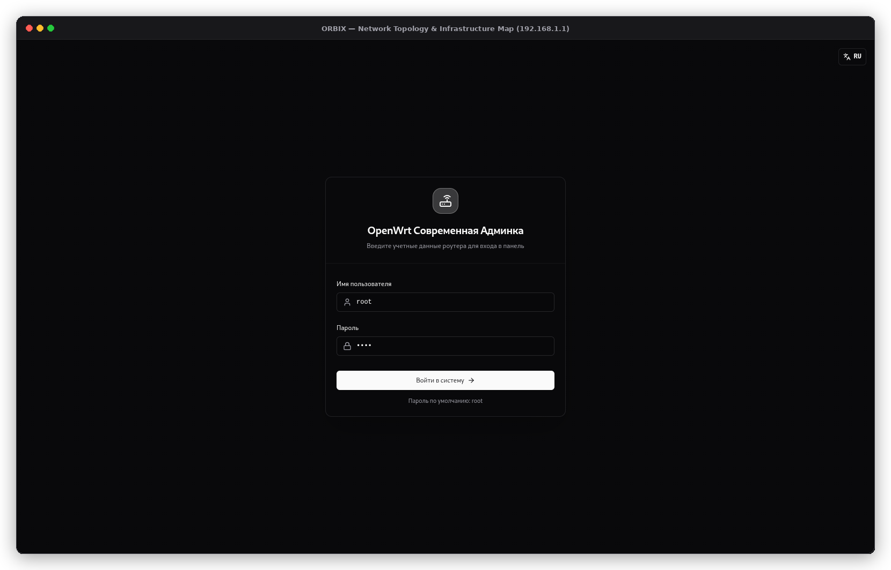

# ORBIX • OpenWrt Network Management Platform

[](https://openwrt.org)
[](https://react.dev)
[](https://ui.shadcn.com)
[](https://www.typescriptlang.org)
[](https://vitejs.dev)
[](#)
[](LICENSE)

[**Читать на русском (README.ru.md)**](README.ru.md)

A next-generation, high-performance web administration interface and network management platform for **OpenWrt routers**, designed with strict **shadcn/ui zinc** aesthetics. 

**ORBIX** transforms OpenWrt into an intuitive, visual, and secure networking platform for both home users and network engineers. Built directly on top of OpenWrt's native **ubus**, **UCI**, and **sysfs** architecture with **zero mocks or stubs**.

---

## Star History

[](https://star-history.com/#cyberhard/orbix&Date)

---

## Quick One-Line Installation

Connect to your OpenWrt router via SSH and run:

```sh
sh -c "$(wget -qO- https://raw.githubusercontent.com/cyberhard/orbix/main/scripts/install.sh)"
```

*Supports OpenWrt 21.02, 22.03, 23.05, 24.10, and 25.12+ (auto-detects `apk` and `opkg`).*

---

## Interface Previews

### 1. Interactive Network Topology & Infrastructure Map (`#/traffic`)
Real-time Cisco Packet Tracer-style interactive topology view. Drag-and-drop nodes with live cable recalculation, port status indicators, and instant node inspection.


### 2. Overview Dashboard & Telemetry (`#/overview`)
Real-time CPU, RAM, Flash, active DHCP leases with correct pluralization, WAN status, and smooth SVG throughput graph with time range selector.


### 3. Unified Policy-Based Routing Engine (`#/policies`)
Dual-mode policy manager (Simple Mode for beginners, Expert Mode for network architects) translating natural requirements into atomic `nftables`, `pbr`, and `zapret` rules.


### 4. Hardware Catalog & Universal Firmware Portal (`#/install`)
Pre-compiled OpenWrt images, SHA-256 checksums, and step-by-step flashing guides for MediaTek Filogic, x86/64, and Qualcomm routers.


---

## Key Capabilities

### 1. Interactive Network Topology (Cisco Packet Tracer Aesthetic)
- **Interactive SVG Canvas**: Visual infrastructure map with dot-matrix grid workspace.
- **Full Drag-and-Drop**: Reposition any node in real-time with automatic cable/link recalculation. Positions are saved persistently in `localStorage`.
- **Live Hardware & Client Detection**: Automatically maps Core Router (`192.168.1.1`), Internet WAN (`eth0`), Sing-box VLESS (`tun0`), Switch (`eth1-eth3`), Wi-Fi 5 GHz (`phy0.1-ap0`), Wi-Fi 2.4 GHz (`phy0.0-ap0`), and all active DHCP/ARP client hosts.
- **Port Status & Cable Indicators**: Real-time port dots, interface labels (`eth0`, `tun0`, `5GHz`, `2.4GHz`), and link speeds.
- **Node Inspector & Search**: Instant device inspection (IP, MAC, signal dBm, link speed, assigned routing rule) and live keyword search.
- **SVG Export**: One-click vector topology snapshot download.

### 2. First-Run Setup Wizard (`#/wizard`)
- **7-Step Guided Setup**:
  1. **Welcome**: Choose between **Simple Mode** (safe defaults) and **Expert Mode** (full network control).
  2. **Hardware Detection**: Auto-detects router model, SoC, RAM, flash overlay, network ports, and DPI/VPN acceleration.
  3. **Internet (WAN/LAN)**: IPoE/DHCP, PPPoE, Static IP with **Subnet Collision Resolver** (auto-shifts LAN to `192.168.2.1` if ISP assigns `192.168.1.x`).
  4. **Wi-Fi Radios**: Band Steering (Smart Connect 2.4G/5G), WPA2/WPA3 Mixed encryption, and isolated Guest Network.
  5. **Security & SSH**: Root password strength meter and Dropbear SSH hardening (LAN-only binding).
  6. **Bypass & Core Services**: One-click enable for Zapret2 (ALT11 strategy), RuNet Direct routing, Smart DNS, and VLESS Reality.
  7. **Safety Rollback Watchdog**: 75-second countdown timer reverts configuration if client connectivity is dropped.

### 3. Full Configuration JSON Backup & Migration (`#/backup`)
- **Versioned JSON Schema** (`orbix-config` v1): Covers General, Network, Devices, Policies, VPN, DNS, Zapret, Firewall, and Lists.
- **Safe Export vs Encrypted Full Backup**: Scrubbed secrets for public sharing or **AES-256-GCM** (PBKDF2 10k iterations) encrypted backup with pure TypeScript fallback for plain HTTP (`http://192.168.1.1`).
- **Cross-Device Migration Engine**: Automatically resolves hardware differences and subnet conflicts when restoring to a different router model.
- **Restoration Modes**: Merge, Replace, or Selective section restore.

### 4. DPI Circumvention & Traffic Routing Suite
- **Zapret2 DPI Bypass**: Embedded `nfqws` engine running the battle-tested **ALT11 strategy** (`fake`, `disorder`, `multisplit`, `badseq`) for YouTube 1080p/4K and Discord voice unblocking.
- **RuNet Direct Routing**: Automatic direct unthrottled path for Russian services (.ru, .рф, banking, Gosuslugi) bypassing VPN tunnels.
- **Smart DNS Resolver**: Split-horizon resolution using Yandex DNS for domestic services and secure Google DoH/DoT for international domains.
- **Sing-box VLESS / Reality & AmneziaWG**: High-speed fallback proxy and obfuscated WireGuard tunnel (`Jc`, `Jmin`, `Jmax`, `S1`, `S2`, `H1–H4`).
- **Happ VPN Subscriptions**: Universal decoder for `happ://` and `https://` provider URLs with latency-based auto failover.

### 5. Universal Distribution & Hardware Catalog (`#/install`)
- Tested device profiles for MediaTek Filogic (**Netcraze NC-1812**, **Cudy WR3000**, **Xiaomi AX3000T**, **GL-MT3000**), **x86/64**, and Qualcomm IPQ40xx.
- Beginner-friendly flashing guide (Factory vs Sysupgrade, TFTP / U-Boot recovery).
- Automated ImageBuilder pipeline (`scripts/build-firmware.sh`) with SHA-256 checksums.

---

## Architecture & Technology Stack

```
ORBIX Web UI (React 19 + TypeScript + Vite 8 + Tailwind CSS + shadcn/ui zinc)
   │
   ├── JSON-RPC / ubus HTTP API Gateway
   │      ├── file (native /tmp/dhcp.leases and /proc/net/arp fallback)
   │      ├── network.wireless & iwinfo (native radio configuration & scanning)
   │      ├── uci (get, set, commit, apply)
   │      ├── system / rc / service (telemetry, daemons, procd)
   │      └── circumvention (hardened ORBIX RPC backend: awg, zapret, pbr, zero-lockout watchdog)
   │
   ├── Policy Routing & Security Engine
   │      ├── Linux Kernel 6.6 / 6.12 Routing Tables & IP Rules
   │      ├── nftables / fw4 Table Sets
   │      ├── Zapret2 (nfqws / tpws DPI desync engine)
   │      └── Sing-box / AmneziaWG Tunnels
   │
   └── OpenWrt Base System (MediaTek Filogic / x86_64 / ARM / MIPS)
```

---

## Documentation Suite

Complete technical documentation is available in the [`docs/`](docs/) directory:

- [Project Audit Matrix](docs/PROJECT_AUDIT.md) — 29-module production readiness audit.
- [Security Vulnerability Audit](docs/SECURITY_AUDIT.md) — Audit of shell execution, RPC ACL, and rollback mechanics.
- [Security Architecture & Threat Model](docs/SECURITY.md) — Zero-lockout guarantees, least-privilege RPC, and safe updates.
- [Platform Architecture Specification](docs/ARCHITECTURE.md) — HAL, policy compiler, and LuCI decoupling.
- [Universal Installation & Update Guide](docs/INSTALLATION.md) — CLI installer, offline bundle, recovery flags.
- [Hardware Compatibility Matrix](docs/COMPATIBILITY.md) — Verified SoCs, Wi-Fi 6/7 radios, RAM requirements.
- [Configuration Specification](docs/CONFIGURATION.md) — `orbix-config` JSON specification and AES-GCM encryption.
- [API Reference](docs/API.md) — Complete Ubus JSON-RPC API specification.
- [Developer Guide](docs/DEVELOPMENT.md) — Local development, mocking, vitest suite, conventions.
- [Future Roadmap](docs/ROADMAP.md) — Multi-WAN failover, mwan3, fleet cloud controller.

---

## Testing & Quality Assurance

ORBIX includes a comprehensive unit and integration test suite:

```sh
npm test
```

```
✓ tests/hal.test.ts (3 tests)
✓ tests/security-validation.test.ts (4 tests)
✓ tests/policy-engine.test.ts (5 tests)
✓ tests/config-management.test.ts (5 tests)

Test Files  4 passed (4)
Tests       17 passed (17)
```

---

## License

MIT © [cyberhard](https://github.com/cyberhard)
