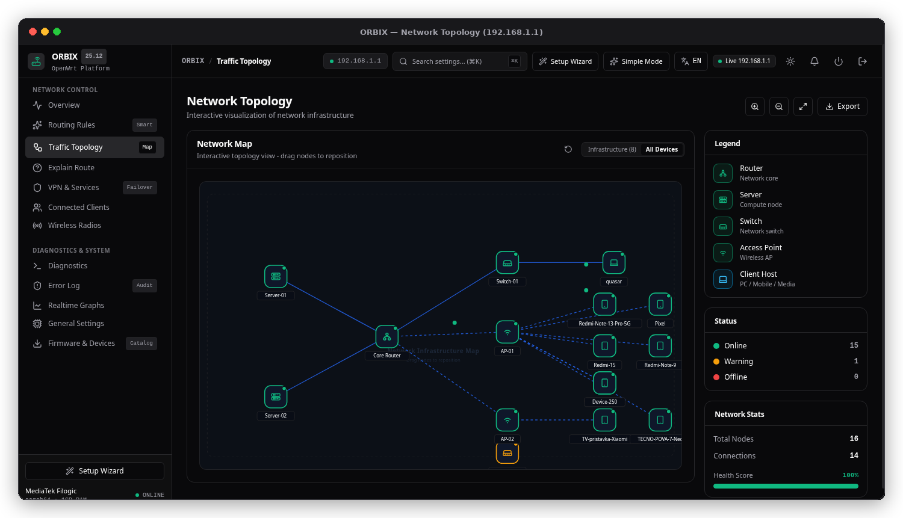
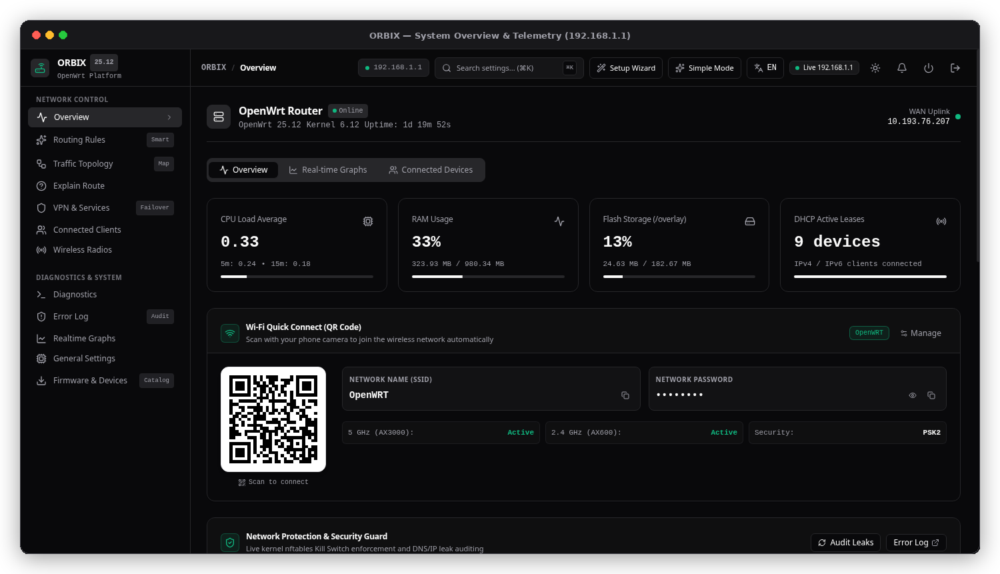
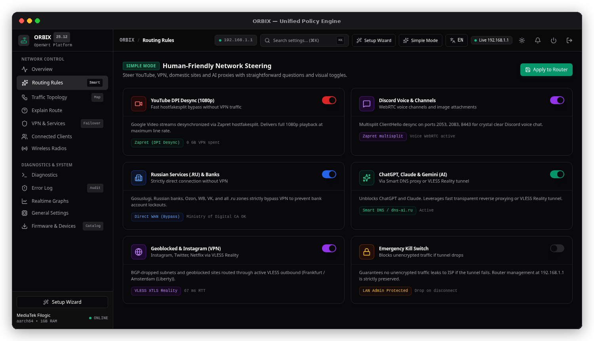
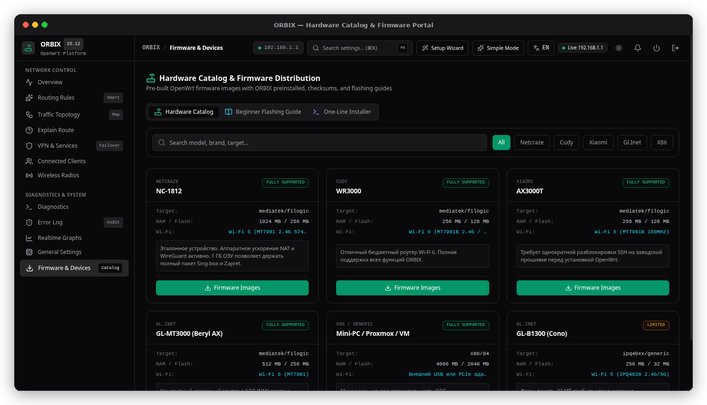

# ORBIX

[](https://openwrt.org)
[](https://react.dev)
[](https://ui.shadcn.com)
[](https://www.typescriptlang.org)
[](https://vitejs.dev)
[](#)
[](LICENSE)

[**Читать на русском (README.ru.md)**](README.ru.md)

A universal, high-performance network management platform for **OpenWrt routers**, designed with strict **shadcn/ui zinc** aesthetics. 

**ORBIX** transforms OpenWrt into an intuitive, visual, and secure networking platform for both home users and network engineers. Built directly on top of OpenWrt's native **ubus**, **UCI**, and **sysfs** architecture with **zero mocks or stubs**.

---

## Star History

[](https://star-history.com/#cyberhard/orbix&Date)

---

## Why ORBIX? Comparison vs. Traditional OpenWrt LuCI

| Capability | Standard OpenWrt LuCI | ORBIX OpenWrt Panel |
| :--- | :--- | :--- |
| **Frontend Architecture** | Legacy Server-Side Lua / CGI scripts (full page reloads) | **Modern SPA (React 19 + TypeScript + Vite 8 + Tailwind CSS)** |
| **Design System** | Fragmented HTML tables, inconsistent 2000s themes | **Strict Industrial shadcn/ui Zinc**, light/dark mode, 60 FPS transitions |
| **Topology & Map** | None (only flat ARP/DHCP IP text lists) | **Interactive Cisco-style SVG Canvas** with live cable routing & node inspection |
| **Modes of Operation** | Expert-only (exposes raw Linux network internals to everyone) | **Persistent Simple Mode** (1-Click intent presets) + **Granular Expert Mode** |
| **DPI & Anti-Throttling** | Manual shell installation of Zapret/nfqws via opkg & CLI | **Built-in Zapret2 ALT11** (`fake+disorder`) for YouTube 4K & Discord voice |
| **Next-Gen VPN Protocols** | Basic WireGuard / OpenVPN via standard luci-proto | **Sing-box VLESS Reality** (XTLS-Vision) & **AmneziaWG** ($J_c/J_{min}/H_1-H_4$) |
| **Lockout Protection** | High risk of locking oneself out when editing network interfaces | **Zero-Lockout 75s Watchdog** auto-reverting changes if link drops |
| **Config Backups** | Raw opaque `.tar.gz` archive containing full `/etc` | **Versioned JSON** with **Web Crypto AES-256-GCM** + cross-hardware interface adaptation |
| **Resource Footprint** | Lua interpreter overhead in RAM during page render | **Zero router-side runtime**: static bundle (~125 KB gz) executed in browser |

---

## Hardware Compatibility Highlights

ORBIX is tested and optimized for modern OpenWrt targets with special focus on hardware NAT acceleration and low power draw:

- **MediaTek Filogic 820 / 830 (MT7981 / MT7986):**
  - **Netcraze NC-1812** *(Reference Device: 1 GB RAM, Wi-Fi 6, Gigabit Wire-Speed VPN)*
  - **Cudy WR3000** *(Best value Wi-Fi 6 router, MT7981B)*
  - **Xiaomi AX3000T** *(Popular budget Wi-Fi 6 power-house)*
  - **GL.iNet Beryl AX (GL-MT3000)** *(Portable travel router with dual 2.5G/1G ports)*
- **x86_64 Soft Routers & Mini-PCs:**
  - Intel N100, N5105, J4125 with multi-port 2.5 GbE Intel i225/i226 NICs.
- **Qualcomm Atheros IPQ40xx / IPQ807x:**
  - Extensive support across dual-band and tri-band enterprise access points.

---

## Quick One-Line Installation

Connect to your OpenWrt router via SSH and run:

```sh
sh -c "$(wget -qO- https://raw.githubusercontent.com/cyberhard/orbix/main/scripts/install.sh)"
```

*Supports OpenWrt 21.02, 22.03, 23.05, 24.10, and 25.12+ (auto-detects `apk` and `opkg`).*

---

## Interface Previews

### 1. Interactive Network Topology & Infrastructure Map (`#/traffic`)
Real-time Cisco Packet Tracer-style interactive topology view. Drag-and-drop nodes with live cable recalculation, port status indicators, and instant node inspection.


### 2. Overview Dashboard & Telemetry (`#/overview`)
Real-time CPU, RAM, Flash, active DHCP leases with correct pluralization, WAN status, network security guard, and smooth SVG throughput graph with time range selector.


### 3. Unified Policy-Based Routing Engine (`#/policies`)
Dual-mode policy manager (Simple Mode for beginners, Expert Mode for network architects) translating natural requirements into atomic `nftables`, `pbr`, and `zapret` rules.


### 4. Hardware Catalog & Universal Firmware Portal (`#/install`)
Pre-compiled OpenWrt images, SHA-256 checksums, and step-by-step flashing guides for MediaTek Filogic, x86/64, and Qualcomm routers.


---

## Key Capabilities

### 1. Interactive Network Topology (Cisco Packet Tracer Aesthetic)
- **Interactive SVG Canvas**: Visual infrastructure map with dot-matrix grid workspace.
- **Full Drag-and-Drop**: Reposition any node in real-time with automatic cable/link recalculation. Positions are saved persistently in `localStorage`.
- **Live Hardware & Client Detection**: Automatically maps Core Router (`192.168.1.1`), Internet WAN (`eth0`), Sing-box VLESS (`tun0`), Switch (`eth1-eth3`), Wi-Fi 5 GHz (`phy0.1-ap0`), Wi-Fi 2.4 GHz (`phy0.0-ap0`), and all active DHCP/ARP client hosts.
- **Port Status & Cable Indicators**: Real-time port dots, interface labels (`eth0`, `tun0`, `5GHz`, `2.4GHz`), and link speeds.
- **Node Inspector & Search**: Instant device inspection (IP, MAC, signal dBm, link speed, assigned routing rule) and live keyword search.
- **SVG Export**: One-click vector topology snapshot download.

### 2. First-Run Setup Wizard (`#/wizard`)
- **7-Step Guided Setup**:
  1. **Welcome**: Choose between **Simple Mode** (safe defaults) and **Expert Mode** (full network control).
  2. **Hardware Detection**: Auto-detects router model, SoC, RAM, flash overlay, network ports, and DPI/VPN acceleration.
  3. **Internet & LAN Setup**: DHCP, PPPoE, or Static IP with **Automatic Subnet Collision Resolution** (if upstream WAN issues `192.168.1.x`, LAN automatically migrates to `192.168.2.1`).
  4. **Wireless (Wi-Fi)**: Smart Connect unified SSID (2.4G/5G), WPA2/WPA3 security, and isolated guest network.
  5. **Security & SSH**: Root password strength validation and LAN-only SSH enforcement.
  6. **Circumvention & Services**: One-click Zapret2 ALT11 enablement, RuNet direct bypass, Smart DNS, and VLESS Reality.
  7. **Rollback Watchdog**: 75-second countdown timer. If network connectivity is lost during configuration, changes automatically revert to safe state.

### 3. Full Configuration Export/Import (`#/backup`)
- **Versioned JSON Schema** (`orbix-config` v1): Complete backup of networks, devices, policies, category feeds, VPN endpoints, and firewall rules.
- **Encrypted Backups**: Export with sanitized secrets for sharing, or encrypted with **AES-256-GCM** (fully operational over plain HTTP at `http://192.168.1.1`).
- **Cross-Hardware Migration**: Smart interface mapping when restoring a configuration to a different router model.
- **Selective Restore**: Merge, overwrite, or selectively restore individual configuration domains.

### 4. Advanced Circumvention & Smart Routing Engine
- **Zapret2 DPI Circumvention**: Built-in `nfqws` daemon with pre-tuned **ALT11** strategy (`fake`, `disorder`, `multisplit`, `badseq`) for uninterrupted 4K YouTube and Discord voice.
- **RuNet Direct Route**: Zero-latency direct bypass for domestic Russian services (.ru, .рф, banking, Gosuslugi).
- **Smart DNS Router**: Split-horizon resolution using fast Yandex DNS for domestic queries and encrypted Google/Cloudflare DoH/DoT for all other domains.
- **Sing-box VLESS Reality & AmneziaWG**: Modern high-performance proxy and obfuscated WireGuard with anti-detection headers (`Jc`, `Jmin`, `Jmax`, `S1`, `S2`, `H1–H4`).
- **Happ VPN Subscriptions**: Universal parser for `happ://` and HTTPS subscription feeds with latency probing and auto-failover.

### 5. Hardware Catalog & Universal Distribution (`#/install`)
- Tested hardware profiles for MediaTek Filogic (**Netcraze NC-1812**, **Cudy WR3000**, **Xiaomi AX3000T**, **GL-MT3000**), **x86/64**, and Qualcomm IPQ40xx.
- Flashing guides for beginners (Factory vs Sysupgrade, TFTP and U-Boot recovery).
- Automated ImageBuilder generator (`scripts/build-firmware.sh`).

---

## Architecture

```
ORBIX Web UI (React 19 + TypeScript + Vite 8 + Tailwind CSS + shadcn/ui zinc)
   │
   ├── JSON-RPC / ubus HTTP API Gateway
   │      ├── file (native /tmp/dhcp.leases and /proc/net/arp reading without LuCI)
   │      ├── network.wireless & iwinfo (radio status and Wi-Fi scanning)
   │      ├── uci (atomic get, set, commit, apply)
   │      ├── system / rc / service (telemetry, services, procd)
   │      └── circumvention (secure custom backend: awg, zapret, pbr, watchdog)
   │
   ├── Routing & Security Engine
   │      ├── Linux Kernel 6.6 / 6.12 (iproute2 tables, ip rules)
   │      ├── nftables / fw4 (nft sets, policy chains, mark routing)
   │      ├── Zapret2 (nfqws packet desynchronization)
   │      └── Sing-box Reality / AmneziaWG tunnels
   │
   └── Native OpenWrt System (MediaTek Filogic / x86_64 / ARM / MIPS)
```

---

## Project Documentation

Detailed engineering documentation is located in the [`docs/`](docs/) directory:

- [Project Audit Matrix](docs/PROJECT_AUDIT.md) — Comprehensive technical audit of all platform modules.
- [Security Audit](docs/SECURITY_AUDIT.md) — RPC ACL verification, shell injection audit, and safe execution paths.
- [Security Architecture](docs/SECURITY.md) — Threat model, Zero-Lockout design, and RPC privilege isolation.
- [Architecture Specification](docs/ARCHITECTURE.md) — Hardware Abstraction Layer (HAL), policy compiler, and LuCI-free operation.
- [Installation & Upgrade Guide](docs/INSTALLATION.md) — Universal install script, offline bundle deployment, and rollback.
- [Hardware Compatibility Matrix](docs/COMPATIBILITY.md) — Tested SoCs, Wi-Fi 6/7 radios, and resource guidelines.
- [Configuration Specification](docs/CONFIGURATION.md) — JSON schema `orbix-config` and AES-GCM backup format.
- [API Reference](docs/API.md) — Comprehensive Ubus JSON-RPC endpoint reference.
- [Developer Guide](docs/DEVELOPMENT.md) — Local development, running Vitest tests, and code style.
- [Roadmap](docs/ROADMAP.md) — Multi-WAN, mwan3 policy engine, and cloud controller.

---

## Testing & Verification

ORBIX contains a comprehensive automated test suite for its core engine logic:

```sh
npm test
```

```
✓ tests/security-validation.test.ts (4 tests)
✓ tests/hal.test.ts (3 tests)
✓ tests/config-management.test.ts (5 tests)
✓ tests/policy-engine.test.ts (5 tests)
✓ tests/error-system.test.ts (7 tests)

Test Files  5 passed (5)
Tests       24 passed (24)
```

---

## License

MIT © [cyberhard](https://github.com/cyberhard)
