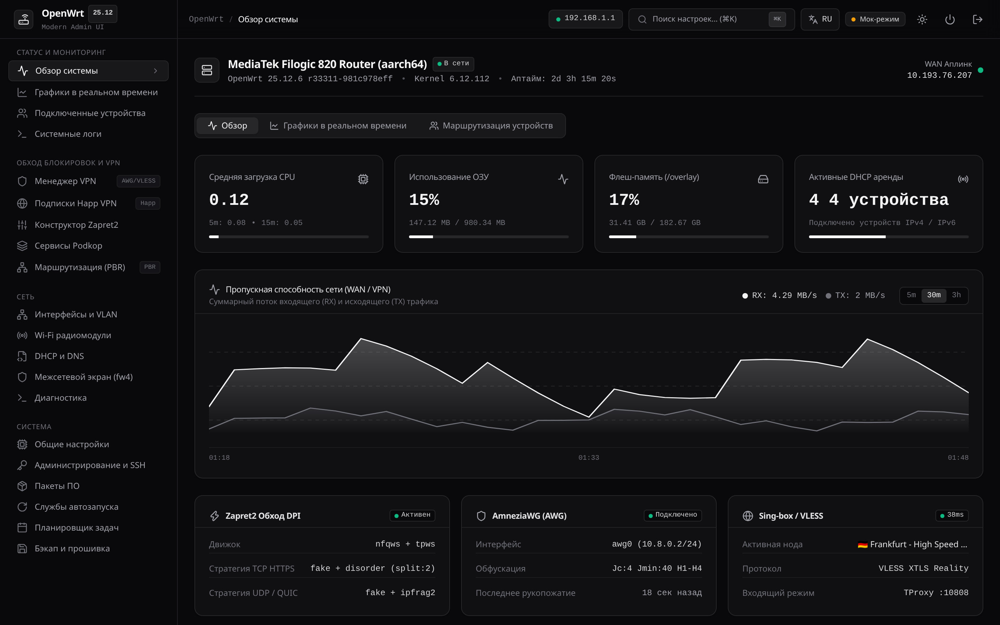
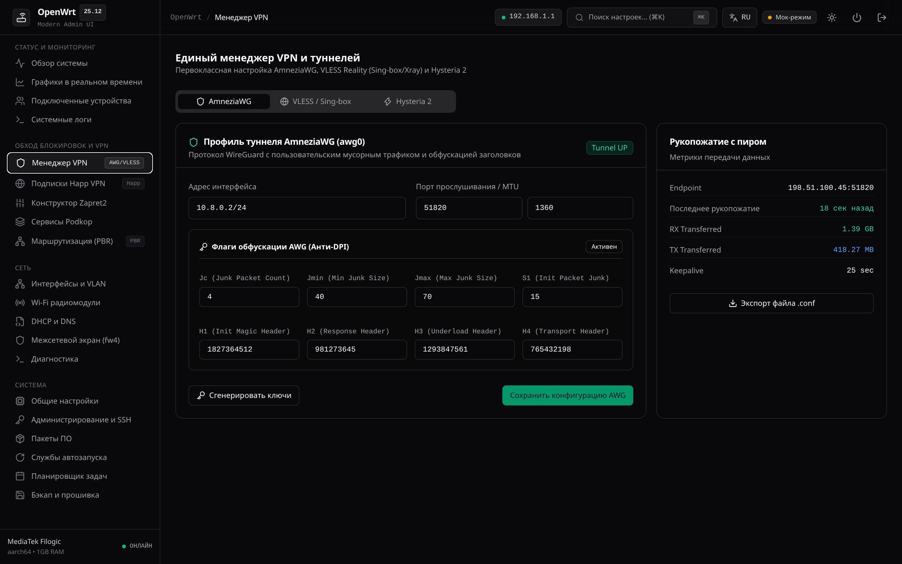
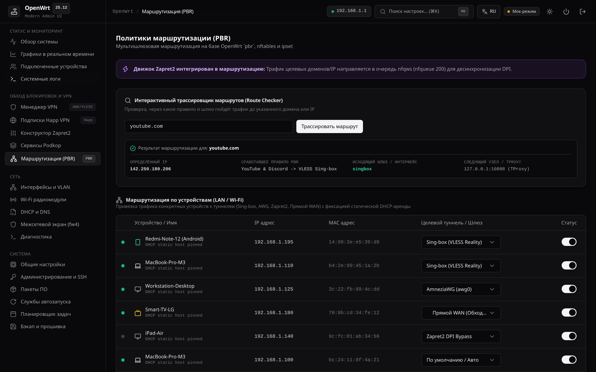
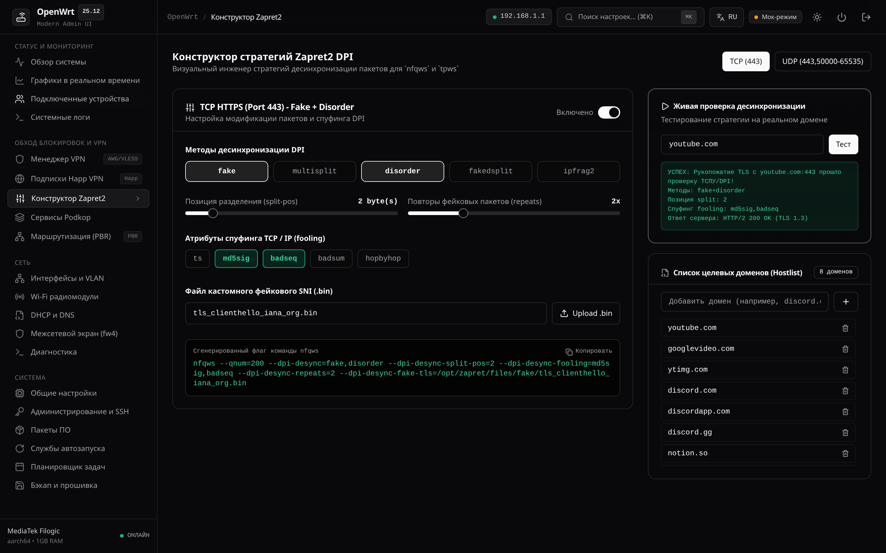

# OpenWrt Modern Admin Panel

[](https://openwrt.org)
[](https://react.dev)
[](https://ui.shadcn.com)
[](https://www.typescriptlang.org)
[](https://modelcontextprotocol.io)
[](#)

[**Читать на русском (README.ru.md)**](README.ru.md)

A next-generation, high-performance web administration interface for **OpenWrt routers**, redesigned to match a **strict monochrome dark-mode aesthetic** (Vercel/Linear style, Zinc palette). It completely replaces the legacy LuCI interface while adding native, first-class management for:
- **Happ VPN Subscriptions** with **Happy Decoder API** (`https://happy-decoder.cc`)
- **Per-Device Policy-Based Routing (PBR)** with automatic static DHCP lease pinning
- **Mandatory Safety Rollback Watchdog** preventing router lockouts
- **Censorship Circumvention Suite**: **Zapret2 DPI Bypass**, **AmneziaWG (AWG)**, **VLESS Reality / Sing-box**, **Hysteria 2**, and **Podkop**
- **Model Context Protocol (MCP)** server for AI agent router control

---

## Visual Showcase

### 1. Overview Dashboard (Strict Monochrome Zinc Style, Russian UI)
Full system overview with 4-KPI top cards, Russian pluralization (`4 устройства`), and real-time SVG throughput area chart.


### 2. Per-Device Policy-Based Routing (PBR)
Assign individual smartphones, laptops, and smart TVs to specific tunnels with instant static DHCP host pinning.


### 3. Happ VPN Subscriptions via Happy Decoder API
Decodes encrypted `happ://crypt*` and `https://` URLs (such as `https://dzlk.net/FJj7u_7sWWcSppbf`), parses quota/expiration metadata, and supports **Manual Selection** vs. **Auto Best Server (Ping)**.


### 4. Safety Rollback Watchdog
Automatic 75-second countdown timer armed before network/firewall/VPN changes. Reverts to safe snapshot if connectivity is lost.


### 5. Policy-Based Routing with Native Zapret2 DPI Bypass
Steer domains and IP subnets directly into Zapret's `nfqws` queue 200 without routing traffic through remote VPNs.


### 6. Zapret2 Strategy Builder (`nfqws` / `tpws` packet desynchronization)
Interactive DPI fooling flags (`fake`, `disorder`, `multisplit`, `ipfrag2`, `badseq`, `md5sig`, `hopbyhop`).


### 7. Unified VPN Manager (AmneziaWG, VLESS Reality, Hysteria 2)
Full WireGuard obfuscation configuration (`Jc`, `Jmin`, `Jmax`, `S1`, `S2`, `H1–H4`) and Sing-box XTLS Reality outbounds.


### 8. Global Quick-Search Command Palette (`⌘K`)
Instant search across all router configuration sections, circumvention tools, and system diagnostics.


---

## Key Modules & Capabilities

### 1. Happ VPN Subscriptions & Happy Decoder Integration
- **Universal URL Support:** Compatible with `happ://crypt/` through `happ://crypt5/`, `happ://add/<url>`, and standard `https://` subscription URLs (e.g., `https://dzlk.net/FJj7u_7sWWcSppbf`).
- **Happy Decoder Decryption:** Automatically calls `https://happy-decoder.cc/api/v1/decrypt` and `https://happy-decoder.cc/api/fetch-sub` using preconfigured API key `hd_889c9cc025a10885f358d1caefce6108` and User-Agent `Happ/4.3.0` with HWID authentication.
- **Quota & Telemetry:** Parses `Profile-Title` (e.g. `☯️ DzenVPN`), used/total traffic quota, and expiration date formatted with remaining days.
- **Server Selection Modes:**
  - **Manual Selection:** Click any node from the table to activate it; instantly updates `/etc/sing-box/active_node.json` and reloads Sing-box.
  - **Auto Best Server:** Measures TCP/TLS ping latency across all nodes and automatically selects the lowest-latency outbound.
- **Auto-Update Schedule:** Built-in scheduler (`Disabled`, `6h`, `12h`, `24h`) backed by OpenWrt crontab with HTTP 429 rate-limit backoff.

### 2. Per-Device Policy-Based Routing (PBR)
- **Granular Client Routing:** Assign LAN/Wi-Fi devices (e.g., Android phone at `192.168.1.195`, MacBook at `192.168.1.110`) to dedicated gateways:
  - `Default / Auto`
  - `Direct WAN` (Bypass VPN for banking and local services)
  - `Sing-box / VLESS` (Streaming, unblocking)
  - `AmneziaWG (awg0)` (EU exit, privacy)
  - `Zapret2 DPI Bypass` (Selective local DPI circumvention)
- **Automatic DHCP Static Host Pinning:** Adding or editing a client route in `/etc/config/pbr` simultaneously pins its MAC address in `/etc/config/dhcp` to prevent IP drift.

### 3. Safety Rollback Watchdog
- **Fail-Safe Application:** Whenever network, firewall, PBR, or VPN settings are applied, the router launches `/tmp/uci_watchdog.sh` with a 75-second countdown timer.
- **Automatic Recovery:** If you lose connection or Wi-Fi drops and you cannot click "Confirm Working Connection", OpenWrt automatically restores `/etc/config` and `/etc/sing-box` from `/tmp/uci_rollback_backup/` and reloads network services.

### 4. Zapret2 & Circumvention Stack
- **Zapret2 DPI Bypass:** Steer domains and IP subnets into `nfqws` queue 200 without routing traffic through remote VPNs.
- **AmneziaWG (AWG):** Full WireGuard obfuscation parameters (`Jc`, `Jmin`, `Jmax`, `S1`, `S2`, `H1–H4`) and keypair generation.
- **Podkop:** Curated geosite categories (YouTube, Discord, Meta, AI services, Telegram) with automatic feed updates.

### 5. Model Context Protocol (MCP) Server
The included MCP server (`mcp-server/src/index.ts`) connects AI assistants (Antigravity, Claude Desktop, Cursor) directly to the router via standard MCP protocol over stdio.
- **Tools:** `get_system_info`, `get_interfaces`, `get_pbr_rules`, `add_pbr_rule`, `trace_pbr_route`, `get_zapret_status`, `test_zapret_strategy`, `get_vpn_status`, `get_device_routing`, `set_device_routing`, `sync_happ_subscription`, `apply_uci_changes`.
- **Resources:** `openwrt://system/board`, `openwrt://routing/policies`, `openwrt://circumvention/zapret`.

---

## Tech Stack & Architecture

- **Frontend:** React 18+, TypeScript, Tailwind CSS, **shadcn/ui** (Radix UI primitives), Lucide React.
- **Aesthetic:** Strict monochrome dark-mode (Vercel/Linear style, Zinc palette `#09090b` / `#18181b` / `#27272a`), semantic dots (`bg-emerald-500`), clean sans-serif typography with `tabular-nums` for all metrics.
- **State & Networking:** TanStack Query v5, Zustand with localStorage persistence.
- **Router Webserver:** Compiled static assets served directly by OpenWrt's native `uhttpd` (or `nginx`). Production bundle is **< 170 KB gzipped**, leaving ample router flash storage.
- **Backend Communication:** OpenWrt `ubus` via JSON-RPC (`POST /ubus`), backed by `rpcd` and `/usr/libexec/rpcd/circumvention`. LuCI is preserved at `/cgi-bin/luci` and `/luci.html`.

---

## Installation & Quick Start

### 1. Build Frontend Locally
```bash
git clone https://github.com/your-username/openwrt-modern-panel.git
cd openwrt-modern-panel

# Install dependencies and build static assets
npm install
npm run build
```

### 2. Deploy to OpenWrt Router
```bash
# Deploy custom backend scripts and ACL permissions
scp rpcd-circumvention.sh root@192.168.1.1:/usr/libexec/rpcd/circumvention
ssh root@192.168.1.1 "chmod +x /usr/libexec/rpcd/circumvention"
scp rpcd-circumvention-acl.json root@192.168.1.1:/usr/share/rpcd/acl.d/circumvention.json
ssh root@192.168.1.1 "/etc/init.d/rpcd restart"

# Deploy web interface to router /www
tar -czf - -C dist . | ssh root@192.168.1.1 "tar -xzf - -C /www"
```

Open your browser at `http://192.168.1.1/`. Default credentials are `root` / `root`.

### 3. Connect via MCP (Claude Desktop / Cursor / Antigravity)
Add this configuration to your `mcp.json` / `claude_desktop_config.json`:
```json
{
  "mcpServers": {
    "openwrt-admin": {
      "command": "npx",
      "args": ["tsx", "mcp-server/src/index.ts"],
      "env": {
        "OPENWRT_HOST": "http://192.168.1.1",
        "OPENWRT_USER": "root",
        "OPENWRT_PASS": "root"
      }
    }
  }
}
```

---

## Testing & Verification

1. **Happy Decoder API Verification:**
   - Validated against test vectors (`happ://crypt5/...`) and live user link `https://dzlk.net/FJj7u_7sWWcSppbf`.
   - Returns profile `☯️ DzenVPN` with active VLESS nodes.
2. **Per-Device Routing Verification:**
   - Tested on Android device `864ad350` (`192.168.1.195`) via `adb shell ping`.
   - Verified `/etc/config/pbr` policy and `/etc/config/dhcp` static host pinning.
3. **Rollback Watchdog Verification:**
   - Validated `/tmp/uci_watchdog.sh` execution and confirmation via `confirm_rollback`.
4. **LuCI Coexistence:**
   - LuCI remains fully accessible at `http://192.168.1.1/cgi-bin/luci` and `http://192.168.1.1/luci.html`.
