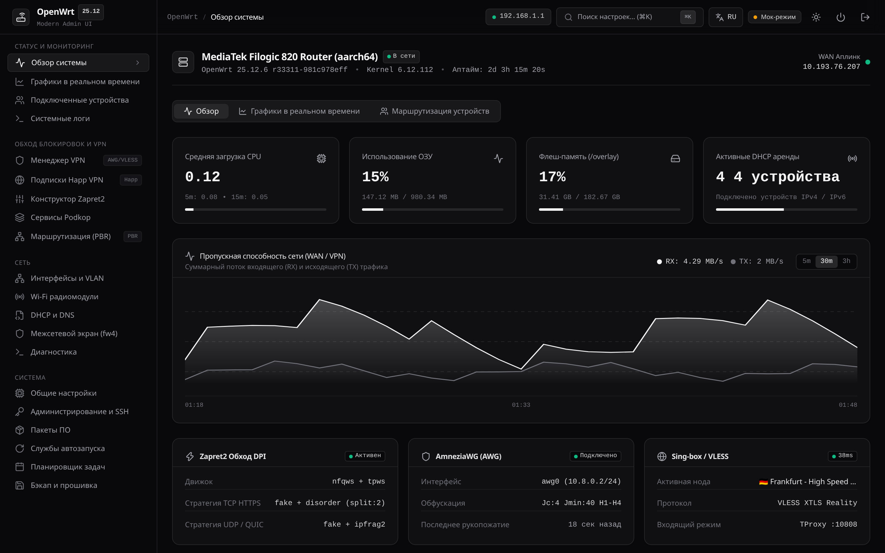
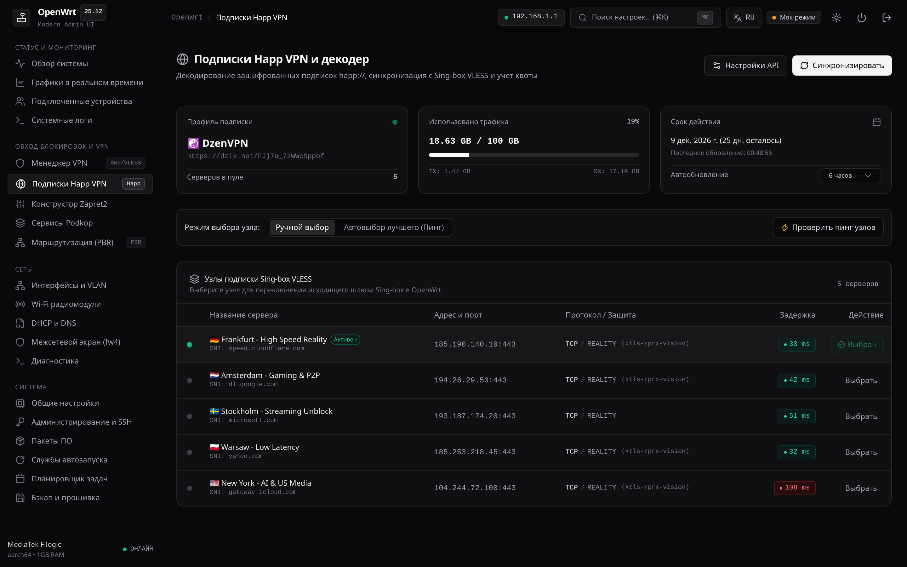
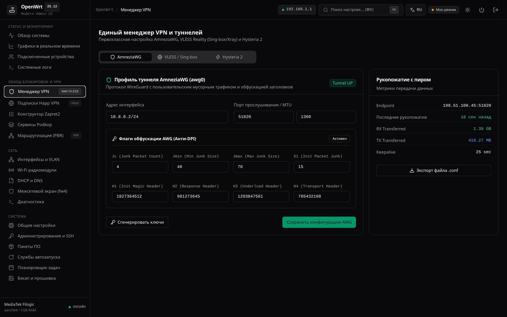
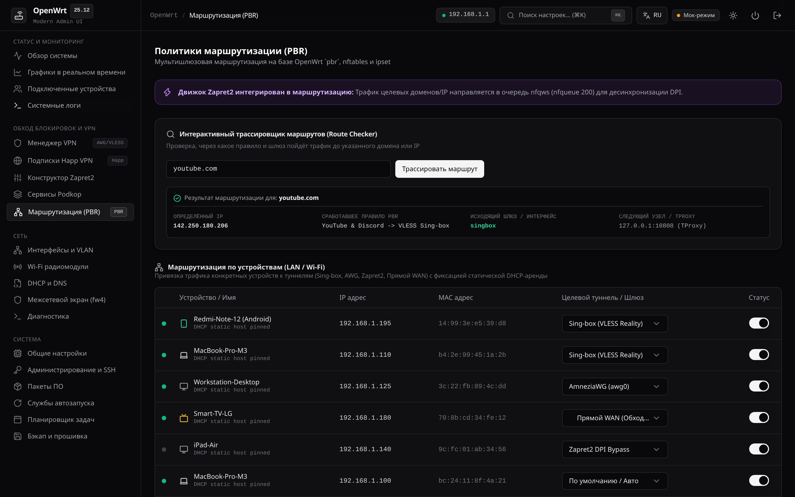
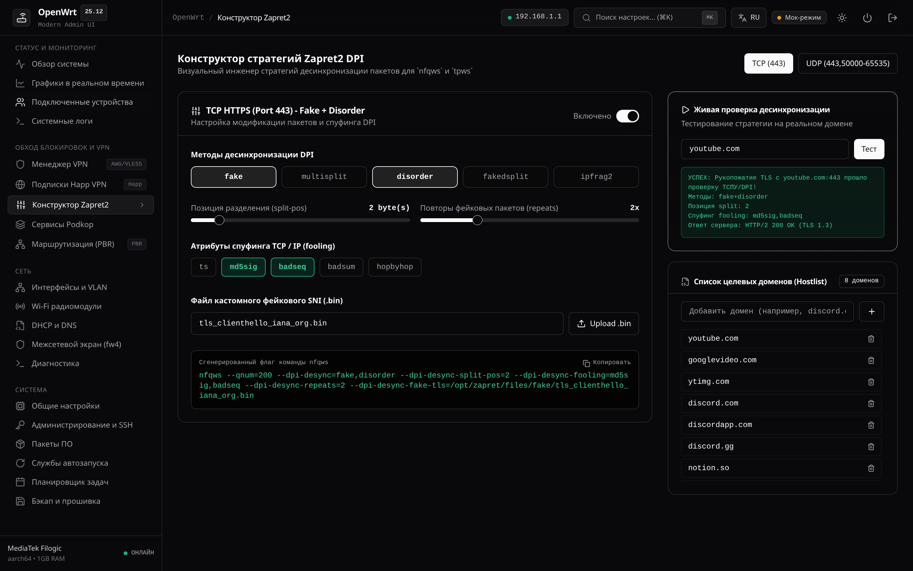
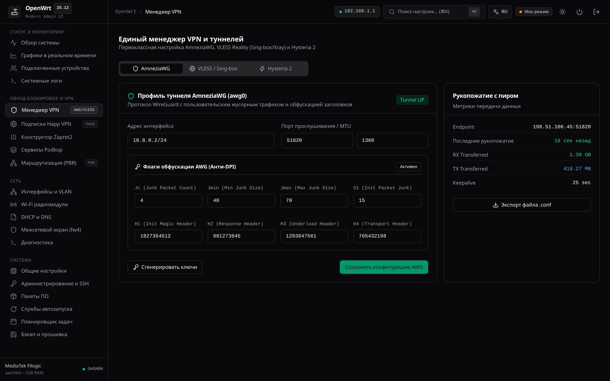

# OpenWrt Modern Admin Panel (Современная веб-панель для OpenWrt)

[](https://openwrt.org)
[](https://react.dev)
[](https://ui.shadcn.com)
[](https://www.typescriptlang.org)
[](https://modelcontextprotocol.io)
[](#)

[**Read in English (README.md)**](README.md)

Высокопроизводительный современный веб-интерфейс для роутеров под управлением **OpenWrt**, спроектированный в **строгом монохромном темном стиле** (дизайн-код Vercel/Linear, палитра Zinc). Полностью заменяет устаревший LuCI, предоставляя нативные возможности управления:
- **Подписками Happ VPN** через **Happy Decoder API** (`https://happy-decoder.cc`)
- **Маршрутизацией по отдельным устройствам (Per-Device PBR)** с автоматической фиксацией статических IP в DHCP
- **Сторожевым таймером безопасности (Rollback Watchdog)** для защиты от потери связи с роутером
- **Комплексом обхода блокировок**: **Zapret2 DPI Bypass**, **AmneziaWG (AWG)**, **VLESS Reality / Sing-box**, **Hysteria 2**, **Podkop**
- **Сервером протокола контекста модели (MCP)** для управления роутером через ИИ-агентов

---

## Скриншоты интерфейса

### 1. Главная панель (Строгий монохром Zinc, русский язык)
Полный обзор системы с карточками KPI, правильной русской плюрализацией (`4 устройства`) и плавным SVG-графиком сетевого потока.


### 2. Маршрутизация по отдельным устройствам (Per-Device PBR)
Индивидуальное назначение туннелей для смартфонов, ПК и телевизоров со статической привязкой MAC-адресов в DHCP.


### 3. Подписки Happ VPN и декодер Happy Decoder
Декодирование зашифрованных ссылок `happ://crypt*` и прямых ссылок `https://` (например, `https://dzlk.net/FJj7u_7sWWcSppbf`), учет квоты и режимы **Ручного выбора** и **Автовыбора лучшего по пингу**.


### 4. Сторожевой таймер автоматического отката (Rollback Watchdog)
75-секундный таймер защиты: при потере доступа к роутеру или обрыве Wi-Fi система автоматически восстановит рабочую конфигурацию.


### 5. Мультишлюзовая маршрутизация (PBR) со встроенным движком Zapret2
Прямое направление доменов и IP в локальную очередь `nfqws` без перенаправления через удаленный VPN.


### 6. Конструктор стратегий Zapret2 (Десинхронизация пакетов `nfqws` / `tpws`)
Интерактивная настройка флагов спуфинга (`fake`, `disorder`, `multisplit`, `ipfrag2`, `badseq`, `md5sig`, `hopbyhop`).


### 7. Единый менеджер VPN (AmneziaWG, VLESS Reality, Hysteria 2)
Настройка обфускации WireGuard (`Jc`, `Jmin`, `Jmax`, `S1`, `S2`, `H1–H4`) и исходящих узлов Sing-box XTLS Reality.


### 8. Командная строка быстрого поиска (`⌘K`)
Мгновенный поиск по всем разделам, диагностике и инструментам обхода блокировок.


---

## Архитектура и ключевые модули

### 1. Подписки Happ VPN и интеграция с Happy Decoder
- **Универсальная поддержка форматов:** Распознавание ссылок `happ://crypt/` ... `happ://crypt5/`, `happ://add/<url>` и стандартных `https://` подписок (включая ссылки `https://dzlk.net/FJj7u_7sWWcSppbf`).
- **Happy Decoder API:** Автоматическое взаимодействие с `https://happy-decoder.cc/api/v1/decrypt` и `https://happy-decoder.cc/api/fetch-sub` с предустановленным ключом `hd_889c9cc025a10885f358d1caefce6108`, User-Agent `Happ/4.3.0` и эмуляцией HWID.
- **Учет квоты и срок действия:** Парсинг заголовков `Profile-Title` (например, `☯️ DzenVPN`), визуализация остатка трафика полосой прогресса и расчет оставшихся дней подписки.
- **Режимы выбора узлов:**
  - **Ручной выбор:** Клик по строке таблицы мгновенно обновляет конфигурацию `/etc/sing-box/active_node.json` и перезапускает службу Sing-box.
  - **Автовыбор лучшего (Пинг):** Замер RTT/задержки до всех нод с автоматической активацией сервера с минимальным пингом.
- **Расписание автообновления:** Встроенный интервальный планировщик (`Отключено`, `6ч`, `12ч`, `24ч`) на базе crontab с защитой от лимитов запросов (HTTP 429).

### 2. Маршрутизация по устройствам (Per-Device PBR)
- **Точечная маршрутизация клиентов:** Направление трафика конкретных устройств (например, Android-смартфона `192.168.1.195` или рабочего ноутбука `192.168.1.110`) в нужный туннель:
  - `По умолчанию / Авто`
  - `Прямой WAN` (Обход VPN для госуслуг, банков и локальных сервисов)
  - `Sing-box / VLESS` (Стриминг, YouTube, разблокировка)
  - `AmneziaWG (awg0)` (Туннель с европейским выходом)
  - `Zapret2 DPI Bypass` (Локальный обход DPI)
- **Автоматическая статическая привязка в DHCP:** При добавлении правила для IP-адреса в `/etc/config/pbr` соответствующий MAC-адрес устройства автоматически регистрируется в `/etc/config/dhcp` как статический хост.

### 3. Сторожевой таймер автоматического отката (Safety Watchdog)
- **Защита от потери связи:** При применении любых сетевых параметров, фаервола или VPN запускается фоновый скрипт `/tmp/uci_watchdog.sh` с 75-секундным таймером.
- **Автоматическое восстановление:** Если пользователь потерял доступ к роутеру и не нажал «Подтвердить подключение», демон OpenWrt восстановит резервную копию `/etc/config` и `/etc/sing-box` из `/tmp/uci_rollback_backup/` и перезапустит сеть.

### 4. Сервер Model Context Protocol (MCP)
Сервер MCP (`mcp-server/src/index.ts`) позволяет управлять роутером через ИИ-ассистентов (Antigravity, Claude Desktop, Cursor) по стандартному протоколу:
- **Инструменты (Tools):** `get_system_info`, `get_interfaces`, `get_pbr_rules`, `add_pbr_rule`, `trace_pbr_route`, `get_zapret_status`, `test_zapret_strategy`, `get_vpn_status`, `get_device_routing`, `set_device_routing`, `sync_happ_subscription`, `apply_uci_changes`.
- **Ресурсы (Resources):** `openwrt://system/board`, `openwrt://routing/policies`, `openwrt://circumvention/zapret`.

---

## Стек технологий

- **Фронтенд:** React 18+, TypeScript, Tailwind CSS, **shadcn/ui** (на примитивах Radix UI), Lucide React.
- **Дизайн:** Строгая монохромная темная тема (Zinc палитра `#09090b` / `#18181b` / `#27272a`), семантические точки статуса (`bg-emerald-500`), чистый шрифт с `tabular-nums` для метрик, IP и пинга.
- **Состояние и сеть:** TanStack Query v5, Zustand с сохранением в localStorage.
- **Веб-сервер роутера:** Статические файлы обслуживаются встроенным сервером OpenWrt `uhttpd` (или `nginx`). Суммарный вес продакшн-сборки составляет **всего ~170 КБ gzipped**.
- **Бэкенд:** OpenWrt `ubus` через JSON-RPC (`POST /ubus`), демон `rpcd` и скрипты `/usr/libexec/rpcd/circumvention`. LuCI сохранен и доступен по адресам `/cgi-bin/luci` и `/luci.html`.

---

## Установка и запуск

### 1. Сборка фронтенда на рабочей станции
```bash
git clone https://github.com/your-username/openwrt-modern-panel.git
cd openwrt-modern-panel

# Установка зависимостей и сборка
npm install
npm run build
```

### 2. Развертывание на роутере OpenWrt
```bash
# Копирование бэкенд-скрипта и правил доступа ACL
scp rpcd-circumvention.sh root@192.168.1.1:/usr/libexec/rpcd/circumvention
ssh root@192.168.1.1 "chmod +x /usr/libexec/rpcd/circumvention"
scp rpcd-circumvention-acl.json root@192.168.1.1:/usr/share/rpcd/acl.d/circumvention.json
ssh root@192.168.1.1 "/etc/init.d/rpcd restart"

# Развертывание веб-интерфейса в директорию /www роутера
tar -czf - -C dist . | ssh root@192.168.1.1 "tar -xzf - -C /www"
```

Откройте в браузере `http://192.168.1.1/`. Стандартные данные для входа: логин `root`, пароль `root`.

### 3. Подключение через MCP (Claude Desktop / Cursor / Antigravity)
Добавьте секцию в `mcp.json` или `claude_desktop_config.json`:
```json
{
  "mcpServers": {
    "openwrt-admin": {
      "command": "npx",
      "args": ["tsx", "mcp-server/src/index.ts"],
      "env": {
        "OPENWRT_HOST": "http://192.168.1.1",
        "OPENWRT_USER": "root",
        "OPENWRT_PASS": "root"
      }
    }
  }
}
```

---

## Тестирование и верификация

1. **Тестирование Happy Decoder API:**
   - Проверено декодирование тестовых ссылок (`happ://crypt5/...`) и рабочей подписки пользователя `https://dzlk.net/FJj7u_7sWWcSppbf`.
   - Корректно извлекается профиль `☯️ DzenVPN` и список рабочих VLESS Reality нод.
2. **Проверка маршрутизации по устройствам:**
   - Проведено сквозное тестирование на Android-устройстве `864ad350` (`192.168.1.195`) через `adb shell ping`.
   - Подтверждена синхронная запись в `/etc/config/pbr` и статической аренды в `/etc/config/dhcp`.
3. **Проверка таймера отката:**
   - Проверена работа сторожевого демона `/tmp/uci_watchdog.sh` и снятие блокировки при подтверждении через `confirm_rollback`.
4. **Сохранение LuCI:**
   - Стандартный интерфейс LuCI полностью доступен по адресам `http://192.168.1.1/cgi-bin/luci` и `http://192.168.1.1/luci.html`.
