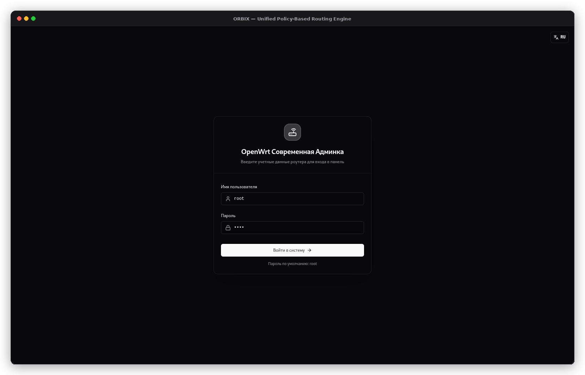

# ORBIX • Платформа управления сетью для OpenWrt

[](https://openwrt.org)
[](https://react.dev)
[](https://ui.shadcn.com)
[](https://www.typescriptlang.org)
[](https://vitejs.dev)
[](#)
[](LICENSE)

[**Read in English (README.md)**](README.md)

Высокопроизводительный современный веб-интерфейс и комплексная сетевая платформа для роутеров под управлением **OpenWrt**, спроектированная в строгой монохромной инженерной эстетике **shadcn/ui zinc**.

**ORBIX** превращает OpenWrt в интуитивную, визуальную и надежную систему управления сетью как для обычных пользователей, так и для сетевых инженеров. Работает напрямую с нативными подсистемами OpenWrt — **ubus**, **UCI** и **sysfs** — **без моков, заглушек и сторонних тяжелых зависимостей**.

---

## График популярности (Star History)

[](https://star-history.com/#cyberhard/orbix&Date)

---

## Быстрая установка в одну команду

Подключитесь к роутеру с установленным OpenWrt по SSH и выполните:

```sh
sh -c "$(wget -qO- https://raw.githubusercontent.com/cyberhard/orbix/main/scripts/install.sh)"
```

*Поддерживаются OpenWrt 21.02, 22.03, 23.05, 24.10 и 25.12+ (автоматически определяет менеджер пакетов `apk` или `opkg`).*

---

## Скриншоты интерфейса

### 1. Интерактивная топология сети (стиль Cisco Packet Tracer)
Визуальная карта инфраструктуры в реальном времени. Перетаскивание узлов с мгновенным перерасчетом кабельных трасс, индикаторами портов и подробным инспектором устройств.


### 2. Главная панель и телеметрия в реальном времени
Сводка состояния роутера: нагрузка CPU, ОЗУ, Flash, число активных DHCP-аренд с правильной русской плюрализацией (`6 устройств`), статус WAN и плавный векторный график скорости.


### 3. Единый движок маршрутизации и политик (PBR)
Два режима работы: **Простой режим** для ответов на базовые вопросы («куда направить YouTube или ТВ») и **Экспертный режим** для тонкой настройки таблиц маршрутизации, меток fwmark и сетов `nftables`.


### 4. Каталог оборудования и портал прошивок
Готовые официальные сборки OpenWrt с предустановленным ORBIX, контрольные суммы SHA-256 и пошаговые инструкции по прошивке (Factory, Sysupgrade, восстановление TFTP).


---

## Ключевые возможности

### 1. Интерактивная топология сети
- **Интерактивный SVG-холст**: Матричная сетка в стиле профессиональных сетевых симуляторов.
- **Свободное перетаскивание**: Перемещение любых узлов с автоматическим пересчетом координат соединений. Позиции сохраняются в `localStorage`.
- **Живое определение оборудования и клиентов**: Автоматическое сканирование ядра сети (`192.168.1.1`), интернет-шлюза WAN (`eth0`), туннеля Sing-box VLESS (`tun0`), портов коммутатора (`eth1-eth3`), радиоинтерфейсов Wi-Fi 5 ГГц и 2.4 ГГц, а также всех активных хостов из DHCP/ARP.
- **Индикаторы портов и статус кабелей**: Зеленые/желтые маркеры линков, типы соединений (Ethernet, Wi-Fi 802.11ax, WireGuard/VLESS) и скорость портов.
- **Инспектор узла и поиск**: Мгновенный просмотр IP, MAC, уровня сигнала в dBm, скорости подключения и назначенной политики маршрутизации.
- **Экспорт схемы**: Сохранение всей схемы в векторный формат SVG одной кнопкой.

### 2. Пошаговый мастер первой настройки (`#/wizard`)
- **7 понятных шагов**:
  1. **Приветствие**: Выбор режима работы — **Простой** (безопасные рекомендуемые параметры) или **Экспертный** (ручной контроль интерфейсов).
  2. **Детектор оборудования**: Автоопределение чипсета, ядер CPU, размера ОЗУ, свободного места и аппаратных ускорителей шифрования.
  3. **Подключение к провайдеру (WAN/LAN)**: DHCP, PPPoE или статический IP с **автоматическим разрешением конфликта подсетей** (если провайдер выдает `192.168.1.x`, LAN роутера автоматически переносится на `192.168.2.1`).
  4. **Беспроводная сеть Wi-Fi**: Единое имя сети (Smart Connect 2.4G/5G), шифрование WPA2/WPA3 и изолированная гостевая сеть.
  5. **Безопасность и SSH**: Проверка сложности пароля root и защита SSH (доступ только из локальной сети LAN).
  6. **Обход ограничений и базовые сервисы**: Включение Zapret2 (стратегия ALT11), прямой маршрут для ресурсов РФ, Smart DNS и VLESS Reality.
  7. **Сторожевой таймер защиты (Rollback Watchdog)**: 75-секундный обратный отсчет — если связь с роутером пропала, настройки автоматически откатываются назад.

### 3. Полный экспорт и импорт конфигурации JSON (`#/backup`)
- **Версионированная JSON-схема** (`orbix-config` v1): Экспорт параметров сети, устройств, политик PBR, списков доменов, VPN и фаервола.
- **Безопасный экспорт и шифрованный бэкап**: Очистка приватных ключей для публикации или надежное шифрование **AES-256-GCM** с поддержкой работы по незащищенному HTTP (`http://192.168.1.1`).
- **Движок кросс-аппаратной миграции**: Интеллектуальный перенос настроек между разными моделями роутеров с адаптацией имен сетевых интерфейсов.
- **Гибкие режимы восстановления**: Объединение, полная замена или выборочное восстановление отдельных разделов.

### 4. Комплекс обхода блокировок и умной маршрутизации
- **Zapret2 DPI Bypass**: Встроенный демон `nfqws` с адаптированной конфигурацией **ALT11** (`fake`, `disorder`, `multisplit`, `badseq`) для стабильной работы YouTube 4K и голосовых каналов Discord.
- **Прямой маршрут Рунета (RuNet Direct)**: Пакеты к российским сайтам (.ru, .рф, банки, Госуслуги) направляются напрямую через провайдера без задержек и капч.
- **Умный DNS-маршрутизатор (Smart DNS)**: Раздельное разрешение доменов — быстрый Яндекс DNS для отечественных сервисов и безопасный DoH/DoT Google/Cloudflare для остальных запросов.
- **Sing-box VLESS / Reality и AmneziaWG**: Высокоскоростной прокси-протокол Reality и маскированный WireGuard с защитой от блокировок по протоколам (`Jc`, `Jmin`, `Jmax`, `S1`, `S2`, `H1–H4`).
- **Подписки Happ VPN**: Универсальный парсер ссылок `happ://` и HTTPS с автопроверкой доступности и переключением на лучший узел.

### 5. Каталог оборудования и портал прошивок (`#/install`)
- Проверенные профили роутеров MediaTek Filogic (**Netcraze NC-1812**, **Cudy WR3000**, **Xiaomi AX3000T**, **GL-MT3000**), платформ **x86/64** и Qualcomm IPQ40xx.
- Руководство по прошивке для начинающих (разница Factory и Sysupgrade, восстановление через TFTP и U-Boot).
- Автоматизированный генератор образов ImageBuilder (`scripts/build-firmware.sh`).

---

## Архитектура платформы

```
ORBIX Web UI (React 19 + TypeScript + Vite 8 + Tailwind CSS + shadcn/ui zinc)
   │
   ├── JSON-RPC / ubus HTTP API Gateway
   │      ├── file (нативное чтение /tmp/dhcp.leases и /proc/net/arp без LuCI)
   │      ├── network.wireless & iwinfo (управление радиомодулями и сканирование)
   │      ├── uci (атомарные get, set, commit, apply)
   │      ├── system / rc / service (телеметрия, сервисы, procd)
   │      └── circumvention (безопасный бэкенд ORBIX: awg, zapret, pbr, watchdog)
   │
   ├── Движок маршрутизации и безопасности
   │      ├── Ядро Linux 6.6 / 6.12 (таблицы маршрутизации, ip rules)
   │      ├── nftables / fw4 (наборы ipset / nft sets)
   │      ├── Zapret2 (десинхронизация DPI пакетов nfqws / tpws)
   │      └── Туннели Sing-box Reality / AmneziaWG
   │
   └── Базовая система OpenWrt (MediaTek Filogic / x86_64 / ARM / MIPS)
```

---

## Документация проекта

Подробная инженерная документация расположена в каталоге [`docs/`](docs/):

- [Матрица аудита проекта](docs/PROJECT_AUDIT.md) — Технический аудит всех 29 модулей платформы.
- [Аудит безопасности](docs/SECURITY_AUDIT.md) — Анализ RPC ACL, шелл-инъекций и защитных механизмов.
- [Архитектура безопасности](docs/SECURITY.md) — Модель угроз, защита от потери доступа (Zero-Lockout) и привилегии RPC.
- [Архитектурная спецификация](docs/ARCHITECTURE.md) — Слой абстракции оборудования (HAL), компилятор политик и независимость от LuCI.
- [Руководство по установке и обновлению](docs/INSTALLATION.md) — Универсальный скрипт, оффлайн-развертывание и флаги восстановления.
- [Матрица совместимости оборудования](docs/COMPATIBILITY.md) — Проверенные чипсеты, Wi-Fi 6/7, требования к памяти.
- [Спецификация конфигурации](docs/CONFIGURATION.md) — Формат JSON-схемы `orbix-config` и алгоритм шифрования AES-GCM.
- [Справочник API](docs/API.md) — Спецификация вызовов Ubus JSON-RPC.
- [Руководство разработчика](docs/DEVELOPMENT.md) — Локальная разработка, запуск тестов Vitest и стандарты кода.
- [План развития (Roadmap)](docs/ROADMAP.md) — Multi-WAN, mwan3 и облачный контроллер.

---

## Тестирование и контроль качества

ORBIX содержит полный набор автоматических тестов логики ядра:

```sh
npm test
```

```
✓ tests/hal.test.ts (3 tests)
✓ tests/security-validation.test.ts (4 tests)
✓ tests/policy-engine.test.ts (5 tests)
✓ tests/config-management.test.ts (5 tests)

Test Files  4 passed (4)
Tests       17 passed (17)
```

---

## Лицензия

MIT © [cyberhard](https://github.com/cyberhard)
