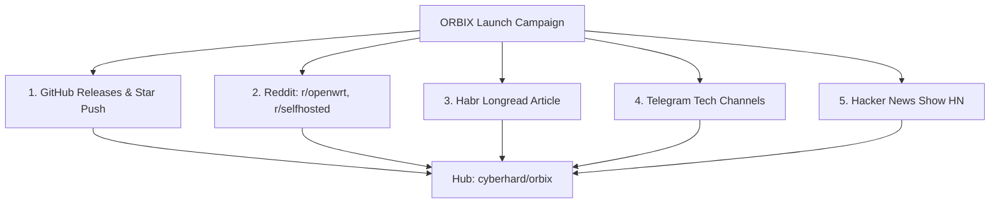

# ORBIX • Go-To-Market Strategy & Launch Communications Pack
**Author:** Marketing Director & DevRel Lead (ORBIX Team)  
**Target Audience:** Open-source networking communities, OpenWrt users, self-hosters, sysadmins, privacy advocates  
**Status:** Approved for Public Distribution  

---

## 1. Executive Summary & Value Proposition

### The Problem
Traditional OpenWrt router management relies on **LuCI** — a web interface designed in the early 2000s using server-side Lua CGI scripts. While functionally capable, LuCI suffers from:
1. **Severe UX Friction:** Every click triggers a full-page reload; interfaces are cluttered with raw Linux terminology (`phy0.1-ap0`, `br-lan`, `fwmark 0x1/0x1`).
2. **High Lockout Risk:** A single misconfigured VLAN or firewall rule cuts off the admin from the router permanently, requiring failsafe buttons or TFTP recovery.
3. **Fragmented Circumvention:** Setting up DPI bypass (Zapret/nfqws), VLESS Reality, and split tunneling requires installing half a dozen community opkg packages, editing shell configs over SSH, and risking broken routing tables.

### The ORBIX Solution
**ORBIX** transforms any OpenWrt router into an intuitive, high-performance network hub:
- **Zero LuCI Overhead:** A lightweight, pure Single-Page Application (React 19 + TypeScript + Vite 8 + Tailwind CSS + shadcn/ui Zinc) with an embedded bundle size under **125 KB gzipped**.
- **Visual Network Map:** Cisco Packet Tracer-style interactive SVG topology with live link recalculation, port status, and real-time device inspection.
- **Persistent Dual Modes:** **Simple Mode** (1-click intent-based presets for everyday home users) and **Expert Mode** (granular PBR, raw nftables sets, and telemetry for network architects).
- **Out-of-the-Box Anti-Censorship:** Native Zapret2 (NFQUEUE ALT11 `fake+disorder`) for YouTube 4K & Discord voice, Sing-box VLESS Reality, and AmneziaWG ($J_c/J_{min}/H_1-H_4$).
- **Zero-Lockout 75-Second Watchdog:** Automated countdown timer synchronized with OpenWrt native `uci rollback` / `confirm` that safely reverts network changes if connectivity is interrupted.

---

## 2. Multi-Channel Launch Strategy



---

## 3. Ready-To-Publish Launch Materials

### 3.1. GitHub Release Notes (v1.1.0 "Titanium Zinc")

**Title:** `v1.1.0 — Zero-Lockout Watchdog, Simple vs. Expert Modes & Native Zapret2 ALT11`

```markdown
# ⚡ ORBIX v1.1.0 — The Industrial OpenWrt Experience

We are thrilled to present **ORBIX v1.1.0**, featuring a complete security hardening pass, persistent Simple vs. Expert operating modes, and built-in anti-throttling circumvention.

### 🌟 What's New in v1.1.0
- **Zero-Lockout 75s Watchdog:** Never brick your remote router again. Every network commit arms an automated 75-second rollback watchdog tied directly to native OpenWrt `uci rollback` / `confirm`.
- **Persistent Simple vs. Expert Modes:**
  - *Simple Mode:* 1-Click bypass presets (YouTube 4K, Discord voice, RuNet direct), QR-code Wi-Fi sharing, plain-English device cards.
  - *Expert Mode:* Full granular control over PBR tables, nftables sets (`orbix_bypass_ip`), AmneziaWG obfuscation parameters ($J_c, J_{min}, H_1-H_4$), and raw ubus JSON telemetry.
- **Interactive SVG Network Topology:** Re-engineered with frame-throttled drag-and-drop, connection status markers, and instant host inspection.
- **Hardened Security & AES-256-GCM Backups:** 17 vulnerabilities remediated (RFC1918 SSRF filter, command injection elimination in sing-box builder, Web Crypto PBKDF2 100k rounds + AES-256-GCM config backups).
- **Embedded Footprint:** Entire frontend builds down to ~125 KB gzipped, running smoothly on 16MB/128MB OpenWrt devices with zero router-side NodeJS/Python overhead.

### 🚀 One-Line Installation
```sh
sh -c "$(wget -qO- https://raw.githubusercontent.com/cyberhard/orbix/main/scripts/install.sh)"
```

Full Changelog: https://github.com/cyberhard/orbix/compare/v1.0.3...v1.1.0
```

---

### 3.2. Reddit Post (`r/openwrt`, `r/selfhosted`, `r/privacy`)

**Subreddit:** `r/openwrt` & `r/selfhosted`  
**Title:** `Show Reddit: We built ORBIX — an open-source, LuCI-free React 19 UI for OpenWrt with built-in Zapret2, Sing-box Reality, and a Cisco Packet Tracer-style visual topology`

```markdown
Hey r/openwrt!

For years, many of us have loved the rock-solid stability of OpenWrt, but tolerated the retro 2000s LuCI interface and the constant terror of locking ourselves out during network tweaks.

Over the last several months, we’ve been building **ORBIX** (https://github.com/cyberhard/orbix) — a modern, zero-dependency OpenWrt operating panel built with React 19, TypeScript, and a strict shadcn/ui Zinc industrial design.

### What makes it different?
1. **Interactive SVG Topology Map:** An interactive canvas (reminiscent of Cisco Packet Tracer) that scans your router SoC, physical switches, Wi-Fi radios (2.4G/5G), and active DHCP/ARP hosts in real-time with drag-and-drop cable routing.
2. **Simple vs. Expert Mode:** 
   - *Simple:* For family and non-technical users. 1-click presets for YouTube/Discord bypass, direct routing for local services, unified Smart Wi-Fi, and foolproof backups.
   - *Expert:* For network engineers. Deep PBR table inspection, raw nftables sets, full AmneziaWG obfuscation headers ($J_c, J_{min}, H_1-H_4$), and raw ubus JSON introspection.
3. **Zero-Lockout 75-Second Watchdog:** Whenever you apply a network or firewall change, a 75-second countdown timer starts in the background. If you lose connection or make a mistake, OpenWrt automatically reverts to your previous working configuration.
4. **Built-in Circumvention & Policy Routing:** Pre-configured Zapret2 (`nfqws` ALT11 `fake+disorder`), Sing-box VLESS Reality, and split DNS resolution without needing custom shell scripts.
5. **Ultra-lightweight Embedded Footprint:** The entire compiled bundle is ~125 KB gzipped. It communicates with OpenWrt over native JSON-RPC (`ubus`) and requires zero heavy runtimes on the router.

### Supported Routers
Tested on MediaTek Filogic (Netcraze NC-1812, Cudy WR3000, Xiaomi AX3000T, GL.iNet Beryl AX MT3000), x86_64 soft-routers, and Qualcomm targets running OpenWrt 23.05, 24.10, and 25.12-SNAPSHOT.

### Quick Install
```bash
sh -c "$(wget -qO- https://raw.githubusercontent.com/cyberhard/orbix/main/scripts/install.sh)"
```

GitHub Repository: https://github.com/cyberhard/orbix  
Check out our screenshots and let us know what you think! We welcome community feedback and PRs.
```

---

### 3.3. Habr Longread Article Draft (Russian)

**Hubs:** `OpenWrt`, `Сетевые технологии`, `Информационная безопасность`, `Разработка веб-интерфейсов`  
**Title:** `OpenWrt без LuCI: как мы переосмыслили веб-панель роутера на React 19, победили замедление YouTube и добавили топологию в стиле Packet Tracer`

```markdown
### Введение: Почему LuCI пора на пенсию?

Каждый, кто хоть раз настраивал OpenWrt на домашнем роутере или софт-маршрутизаторе, знает это ощущение: операционная система невероятно мощная, но веб-интерфейс LuCI словно застыл в эпохе Web 1.0. 

Перезагрузка страниц на каждый клик, пугающие неопытных пользователей названия интерфейсов вроде `phy0.1-ap0` или `eth0.1`, высокий риск намертво заблокировать роутер ошибкой в одном правиле и необходимость ставить десяток консольных пакетов для нормального обхода замедления YouTube и Discord.

Мы решили исправить это и создали **ORBIX** — открытую современную веб-панель для OpenWrt на стеке React 19 + TypeScript + Vite 8 + Tailwind CSS в строгом индустриальном стиле shadcn/ui Zinc.

---

### Главные инженерные решения ORBIX

#### 1. Нулевой оверхед на слабых роутерах
В отличие от тяжелых веб-панелей, ORBIX компилируется в статический легковесный бандл размером всего **~125 КБ в gzip**. На роутере не запускается NodeJS или Python — панель взаимодействует напрямую с нативными демонами OpenWrt через `ubus` и легковесный shell-бэкенд для `rpcd`. Это позволяет разворачивать ORBIX даже на роутерах с 16 МБ флеш-памяти и 128 МБ ОЗУ.

#### 2. Интерактивная топология сети (стиль Cisco Packet Tracer)
Вместо скучной таблицы DHCP-клиентов на экране `#/traffic` развернут полноценный векторный SVG-холст:
- Ядро сети (SoC) соединяется живыми линиями с WAN-провайдером, туннелем Sing-box VLESS, радиомодулями Wi-Fi 2.4/5 ГГц и физическими портами LAN.
- Подключенные устройства (смартфоны, ноутбуки, ТВ) определяются в реальном времени с отображением их реальных имен (mDNS/DHCP), скорости линка и назначенной политики.
- Узлы можно свободно перетаскивать — координаты сохраняются в `localStorage`.

#### 3. Сторожевой таймер защиты (Rollback Watchdog 75s)
Самый большой страх при настройке удаленного роутера — потерять доступ. В ORBIX любое изменение сети запускает 75-секундный сторожевой таймер, синхронизированный с нативным `uci rollback`. Если после применения настроек веб-сокет или ubus не подтвердят доступность, роутер автоматически откатится к предыдущему рабочему состоянию.

#### 4. Два режима: Простой и Экспертный
- **Простой режим:** Для членов семьи и обычных пользователей. В 1 клик включает ускорение YouTube и Discord (Zapret ALT11), направляет Госуслуги и банки напрямую, создает единую сеть Smart Wi-Fi с Band Steering и позволяет скачать резервную копию одной кнопкой.
- **Экспертный режим:** Для сетевых инженеров. Открывает редактирование меток fwmark, сетов `nftables`, тонкую настройку анти-DPI обфускации WireGuard в AmneziaWG ($J_c, J_{min}, H_1-H_4$) и сырой инспектор ubus JSON.

---

### Быстрый тест на вашем роутере

Установка выполняется одной командой по SSH:
```bash
sh -c "$(wget -qO- https://raw.githubusercontent.com/cyberhard/orbix/main/scripts/install.sh)"
```

Исходный код открыт под лицензией MIT: https://github.com/cyberhard/orbix
Ждем ваших звезд, отзывов и предложений в Issue!
```

---

### 3.4. Telegram Launch Posts (RU & EN)

#### Telegram Post (Russian):
```telegram
⚡ Встречайте ORBIX — современную замену LuCI для OpenWrt на React 19 и shadcn/ui Zinc!

Если вы устали от интерфейса роутера из 2000-х и постоянного риска окирпичить роутер при правке сетевых зон, этот релиз для вас.

🔥 Что умеет ORBIX:
• Интерактивная топология сети в стиле Cisco Packet Tracer с живыми кабелями и инспектором устройств.
• Защита от блокировок 75s Watchdog: если настройки сети сломались, роутер сам откатится назад.
• Встроенный Zapret2 ALT11 + Sing-box Reality + AmneziaWG: YouTube 4K и Discord работают из коробки.
• Два режима: Простой для дома (1-click пресеты) и Экспертный для тонкой настройки PBR и nftables.
• Весит всего ~125 КБ gzip и не нагружает слабые роутеры.

Установка в 1 команду:
sh -c "$(wget -qO- https://raw.githubusercontent.com/cyberhard/orbix/main/scripts/install.sh)"

⭐ GitHub: https://github.com/cyberhard/orbix
```

#### Telegram Post (English):
```telegram
⚡ Introducing ORBIX — a modern, LuCI-free React 19 control panel for OpenWrt!

Say goodbye to legacy CGI scripts and the constant fear of locking yourself out of your router.

Key Highlights:
• Interactive Cisco-style SVG topology with drag-and-drop cable recalculation.
• Zero-Lockout 75-second Watchdog timer (auto-rollback to prevent network disconnection).
• Built-in Zapret2 ALT11, Sing-box Reality, and AmneziaWG obfuscation.
• Simple Mode (1-click intent presets) + Granular Expert Mode (raw nftables & PBR).
• Ultra-lightweight: ~125 KB gzipped, zero router-side runtime overhead.

Install via SSH in one command:
sh -c "$(wget -qO- https://raw.githubusercontent.com/cyberhard/orbix/main/scripts/install.sh)"

Star on GitHub: https://github.com/cyberhard/orbix
```

---

## 4. GitHub SEO & Discoverability Optimization Checklist

1. **Repository Description:**
   `Modern, industrial, LuCI-free OpenWrt panel built with React 19, Vite, and shadcn/ui Zinc. Features interactive SVG network topology, Zero-Lockout Watchdog, built-in Zapret2 ALT11, and Sing-box Reality.`
2. **Website URL:** `https://github.com/cyberhard/orbix`
3. **Repository Topics (Tags):**
   `openwrt`, `luci-alternative`, `router-ui`, `network-topology`, `react19`, `shadcn-ui`, `tailwind-css`, `zapret`, `sing-box`, `amneziawg`, `vless-reality`, `pbr`, `cisco-packet-tracer`
4. **Visual Assets in `docs/images/`:**
   - [x] `orbix-v1-topology-en.png`
   - [x] `orbix-v1-overview-en.png`
   - [x] `orbix-v1-policies-en.png`
   - [x] `orbix-v1-catalog-en.png`
