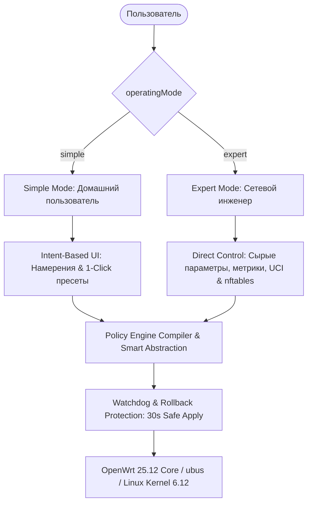
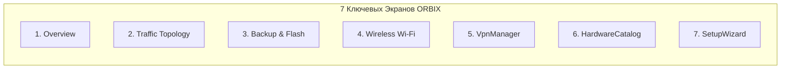
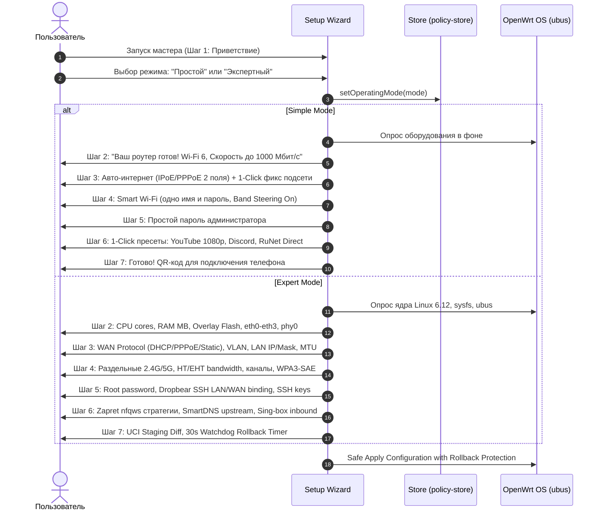

# ORBIX • Product Requirements & UX Specification: Simple Mode vs Expert Mode
**Версия:** 1.0.0  
**Автор:** Директор по продукту (Product Manager ORBIX)  
**Статус:** Approved for Architecture & Implementation (Track 2)  
**Область действия:** Сквозное разделение интерфейса и логики управления маршрутизатором на `operatingMode` ("simple" | "expert")

---

## 1. Executive Summary & Vision

Платформа **ORBIX** решает фундаментальную дилемму современных сетевых роутеров:
- С одной стороны, обычному домашнему пользователю нужен "роутер из коробки", на котором без запинок работает YouTube 1080p/4K, Discord с голосом, банковские приложения и умные устройства без погружения в консоль Linux, iptables и ubus.
- С другой стороны, сетевой инженер и энтузиаст OpenWrt требуют предельного детерминизма: доступ к сырым правилам `nftables`, точным параметрам обфускации `AmneziaWG` ($J_c, J_{min}, S_1, H_1-H_4$), стратегиям `nfqws` (DPI Desync), настройке VLESS Reality в `sing-box`, PBR-таблицам маршрутизации и валидации UCI staging diff.

**Решение:** Внедрение единой реактивной системы сквозного переключения режимов работы (`operatingMode: "simple" | "expert"`), которая меняет глубину отображения данных, терминологию и интерфейс всех 7 ключевых экранов платформы, сохраняя при этом единую надежную кодовую базу и архитектуру безопасности.



---

## 2. Глобальная концепция и правила разделения

### 2.1. Сравнительная матрица философии режимов

| Измерение | Simple Mode ("Простой режим") | Expert Mode ("Экспертный режим") |
| :--- | :--- | :--- |
| **Целевая аудитория** | Домашние пользователи, семьи, геймеры, нетехнические специалисты | Сетевые инженеры, системные администраторы, DevOps, OpenWrt энтузиасты |
| **Ментальная модель** | **Intent-based:** пользователь выражает *желание* ("Хочу быстрый YouTube", "Защитить смарт-ТВ") | **Imperative-based:** пользователь управляет *механизмами* (iproute2 table 100, fwmark, nfqws args) |
| **Сетевые интерфейсы** | Скрыты `phy0.1-ap0`, `eth0.1`, `br-lan`. Заменены на "Wi-Fi 5 GHz", "Проводное подключение", "Гостевая сеть" | Полный список L3/L2 устройств, VLAN tagging, MTU, duplex, switch port mapping |
| **Обход блокировок (DPI)** | 1-Click карточки: YouTube (Zapret), Discord (Voice), RuNet Direct (Банки/Госуслуги) | Конструктор стратегий Zapret2 (split, disorder, fake, oob), параметры очередей nfqws |
| **VPN & Протоколы** | "Вставить ссылку VLESS / импортировать .conf", переключатель Вкл/Выкл, статус пинга | Параметры AmneziaWG ($J_c, J_{min}, J_{max}, S_1, S_2, H_1-H_4$), Reality keys, Inbound TProxy :10808 |
| **Маршрутизация (PBR)** | Наглядная карточка устройства с выбором: "Напрямую / Через VPN / Умный режим" | Таблицы PBR, nftables sets (`orbix_bypass_ip`), CIDR-маски, port range matching |
| **Бэкап и прошивка** | 1-Click "Скачать резервную копию" и "Восстановить настройки" | Выборочный экспорт секций JSON, AES-256-GCM, PBKDF2 rounds, Sysupgrade tar.gz, firstboot -y |
| **Телеметрия** | Скорость интернета (Мбит/с), количество устройств, статус онлайна | 1m/5m/15m load average, RSSI (дБм), MCS rate, socket stats, ubus call counters |

### 2.2. Архитектура состояния и реактивность
1. **Хранилище:** `src/store/policy-store.ts` содержит поле `operatingMode: "simple" | "expert"` с персистентностью в `localStorage`.
2. **Переключатель:** Доступен в шапке (`src/components/layout/Header.tsx`), в мастере настройки (`SetupWizardModal.tsx`) и общих настройках.
3. **Безопасность состояния:** Переключение между режимами происходит **на лету (zero reload)**, без разрыва установленных туннелей и без сброса активных сетевых правил.
4. **Конфликтные правила:** Если в Expert Mode настроено специфическое низкоуровневое правило, в Simple Mode оно отображается как защищенная карточка с бейджем *"Активно (настроено в экспертном режиме)"* без риска случайного удаления.

---

## 3. Спецификация ключевых экранов (Screen-by-Screen)



---

### 3.1. Экран Overview (`src/views/status/Overview.tsx`)

#### Simple Mode:
- **Hero-блок роутера:**
  - Название устройства: дружелюбная модель (напр. *Netcraze NC-1812*).
  - Статус подключения: Крупный индикатор *"Интернет подключен"* (зеленый пульсирующий бейдж) с указанием провайдера/IP.
  - Аптайм в понятном формате: *"Работает без перезагрузки 12 дней"*.
- **Виджет Wi-Fi быстрого подключения:**
  - Высококонтрастный QR-код для моментального сканирования камерой смартфона.
  - Поля имени сети (SSID) и пароля с кнопками скрытия и копирования в один клик.
- **Статус 1-Click сценариев (Bypass Summary):**
  - YouTube 1080p/4K: `[✓ Оптимизировано (Zapret)]`
  - Discord Голос: `[✓ Разблокировано]`
  - Банки и Госуслуги: `[✓ Напрямую через РФ]`
  - VPN-туннель: `[✓ В сети: Нидерланды (42 мс)]`
- **Простая пропускная способность:**
  - Индикатор входящей и исходящей скорости в удобочитаемых Мбит/с.
- **Скрыто:**
  - Таблица физических интерфейсов (`phy0.1-ap0`, `br-lan`, `eth0`).
  - Сырые параметры `nfqws`, `nftables`, `Jc/Jmin/H1-H4`, `TProxy:10808`.
  - Значения Linux Load Average (1m/5m/15m) — заменены на понятную шкалу нагрузки процессора в процентах.

#### Expert Mode:
- **Телеметрия промышленного уровня:**
  - Подробные графики загрузки CPU (1m, 5m, 15m), утилизация RAM (buffers/cached/free), Flash Overlay sysfs хранилище.
- **Карточки сервисов обхода блокировок с глубокой диагностикой:**
  - *Zapret2:* Engine (`nfqws nftables`), TCP стратегия (`fake + disorder (ALT11)`), UDP стратегия (`fake + ipfrag2`), fwmark, номер очереди nfqueue.
  - *AmneziaWG:* Интерфейс `awg0`, параметры обфускации `$J_c, J_{min}, H_1-H_4$`, счетчик handshake, задержка пинга.
  - *Sing-box VLESS Reality:* Живой пинг, транспорт (`TCP/gRPC`), Inbound режим (`tun0 / TProxy :10808`), Public Key SNI.
- **Полная таблица сетевых интерфейсов:**
  - Колонки: Интерфейс, L3 Device (`phy0.1-ap0`, `eth0.1`), Протокол, IPv4/IPv6, RX/TX байты и счетчики пакетов.
  - Прямой доступ к управлению PBR по устройствам.

---

### 3.2. Экран Traffic & Topology (`src/views/traffic/TrafficFlow.tsx`)

#### Simple Mode:
- **Ориентация на устройства (Device-Centric):**
  - Устройства отображаются понятными иконками (iPhone, MacBook, Smart TV, PlayStation) с их именами (по DHCP/mDNS) вместо `host-192-168-1-178`.
  - Точки Wi-Fi подписаны как *"Wi-Fi 5 GHz"* и *"Wi-Fi 2.4 GHz"* (скрыты `phy0.1-ap0`, `phy0.0-ap0`).
- **Визуальные потоки трафика:**
  - Четко различимые цветные линии:
    1. *Зеленая линия:* Прямой интернет (RuNet).
    2. *Фиолетовая линия:* Защищенный VPN туннель.
    3. *Оранжевая линия:* Ускоритель YouTube/Discord.
- **Интерактивная карточка устройства (при клике):**
  - Название устройства, статус (В сети / Не в сети), текущая скорость.
  - Переключатель маршрутизации устройства в 1 клик:
    - `[ Автоматически по правилам ]`
    - `[ Всегда через VPN ]`
    - `[ Всегда напрямую ]`

#### Expert Mode:
- **Полная топология OpenWrt SoC & Network Bus:**
  - Отображение WAN Uplink -> Netfilter Mangle/Prerouting -> Core SoC Router -> Bridge `br-lan` -> Физические порты (Eth 1-4) -> Wi-Fi интерфейсы (`phy0.1-ap0`, `phy0.0-ap0`, `phy0.2-guest`) -> Клиентские станции.
  - Отображение виртуальных туннельных интерфейсов: `singbox_tun`, `awg0`.
- **Инженерная панель узла:**
  - MAC-адрес с Vendor OUI, точный L3/L2 интерфейс.
  - Wi-Fi PHY метрики: RSSI (дБм), уровень шума, MCS Index, канальная скорость (Link Speed).
  - PBR привязка: Table ID (`table 100/200`), fwmark, членство в nftables set (`orbix_bypass_ip`), DNS upstream.

---

### 3.3. Экран Резервного копирования и прошивки (`src/views/system/BackupFlash.tsx`)

#### Simple Mode:
- **1-Click Резервная копия:**
  - Большая кнопка *"Скачать резервную копию роутера"*.
  - Автоматически создает единый файл с Wi-Fi паролями, правилами обхода и системными параметрами.
  - Никаких пугающих чекбоксов: "Включить secrets", "PBKDF2 100k rounds", "AES-256-GCM".
- **1-Click Восстановление:**
  - Простое перетаскивание файла (Drag & Drop) и кнопка *"Восстановить настройки"*.
  - Понятное подтверждение: *"Ваши настройки Wi-Fi и обхода блокировок будут возвращены из файла"*.
- **Скрыто:**
  - Вкладка Sysupgrade `tar.gz`.
  - Опасный сброс к заводским настройкам (`/sbin/firstboot -y`).
  - Выборочный селектор JSON-секций и Diff-просмотрщик.

#### Expert Mode:
- **Гранулярный перенос и аудит конфигурации (JSON):**
  - Выбор конкретных экспортируемых секций: `general`, `network`, `devices`, `policies`, `vpn`, `dns`, `zapret`, `firewall`.
  - Переключатель маскирования приватных ключей (`includeSecrets`).
  - Шифрование бэкапа паролем с применением `AES-256-GCM` и `PBKDF2 (100 000 итераций)`.
  - Интерактивный Diff-просмотрщик импорта с режимами `Merge`, `Overwrite` и `Selective Apply`.
- **Системные операции OpenWrt:**
  - Вызов `/sbin/sysupgrade -b /tmp/backup.tar.gz` для бинарного архива.
  - Прошивка заводских образов OpenWrt (Factory/Sysupgrade) с валидацией SHA-256.
  - Сброс overlay-раздела (`firstboot -y`) с подтверждением.

---

### 3.4. Экран Wi-Fi (`src/views/network/Wireless.tsx`)

#### Simple Mode:
- **Smart Wi-Fi (Единая домашняя сеть):**
  - Единый выключатель Wi-Fi сети.
  - Одно общее поле *"Имя сети (SSID)"* для 2.4 GHz и 5 GHz.
  - Одно поле *"Пароль Wi-Fi"* с валидацией надежности и кнопкой скрытия.
  - Включенная по умолчанию функция **Band Steering** (роутер сам распределяет устройства между 2.4 GHz и 5 GHz для максимальной скорости).
  - 1-Click Гостевая сеть: *"Включить изолированный Wi-Fi для гостей без доступа к домашним устройствам"*.
- **Скрыто:**
  - Раздельные карточки радиомодулей с техническими названиями чипов.
  - Выбор HT-режимов: `EHT20`, `EHT40`, `EHT80`, `EHT160`, `EHT320`.
  - Номера радиоканалов (1..165), частоты в GHz, параметры DFS.
  - Сырой сканер эфира с dBm и MAC-адресами соседних роутеров.

#### Expert Mode:
- **Полное управление каждым физическим радиомодулем (802.11be / Wi-Fi 7 / Wi-Fi 6):**
  - Выбор ширины полосы пропускания: HT20, VHT80, HE160, EHT320 (MLO support).
  - Выбор каналов, включая радарные DFS-каналы (Dynamic Frequency Selection).
  - Мощность передатчика (TxPower) в dBm / мВт, Country Code региона.
  - Протоколы безопасности: WPA2-PSK (CCMP), WPA3-SAE, WPA2/WPA3 Mixed, 802.1X Enterprise, OWE.
  - Сканер радиоэфира (In-depth Wi-Fi Scanner) с графиком спектра, уровнем сигнала RSSI и шума Noise.
  - Client Isolation, WMM (QoS), BSS Coloring, Target Wake Time (TWT).

---

### 3.5. Экран VPN и обхода блокировок (`src/views/circumvention/VpnManager.tsx`)

#### Simple Mode:
- **3 простых действия:**
  1. *Добавить VPN:* Кнопка добавления с поддержкой вставки ссылки (`vless://...`, `vmess://...`) или загрузки готового файла конфигурации AmneziaWG (`.conf`).
  2. *Статус VPN:* Переключатель Вкл/Выкл с отображением флага страны, локации сервера и пинга (зеленый бейдж *"45 мс"*).
  3. *Защита от утечек (Kill Switch):* Понятный переключатель: *"Блокировать заблокированные сайты при обрыве VPN, чтобы не раскрыть реальный IP"*.
- **1-Click пресеты правил обхода:**
  - `[✓] YouTube в 1080p/4K` — работает через встроенный ускоритель Zapret без траты лимита VPN.
  - `[✓] Discord (голос и чаты)` — работает через Zapret.
  - `[✓] Сайты РФ и Банки` — направляются строго напрямую (RuNet Direct).
  - `[✓] Заблокированные соцсети и AI` — направляются через добавленный VPN.
- **Скрыто:**
  - Поля AmneziaWG: $J_c, J_{min}, J_{max}, S_1, S_2, H_1, H_2, H_3, H_4$.
  - MTU, ListenPort, AllowedIPs, Endpoint IP, WireGuard PrivateKey.
  - Sing-box Reality Public Key, Short ID, SpiderX, Inbound `TProxy :10808`.
  - Сложные таблицы Failover и балансировки Multi-WAN.

#### Expert Mode:
- **Вкладка AmneziaWG (AWG Deep Tuning):**
  - Редактирование всех параметров анти-DPI обфускации протокола WireGuard:
    - $J_c$ (Junk packet count), $J_{min} / J_{max}$ (Junk packet size range).
    - $S_1 / S_2$ (Handshake message junk bytes).
    - $H_1, H_2, H_3, H_4$ (Custom protocol header magic values).
  - Настройка MTU (1280–1420), Listen Port, Persistent Keepalive.
  - AllowedIPs маршрутизация (CIDR).
  - Статистика рукопожатий (latest handshake seconds ago), счетчики RX/TX байт.
- **Вкладка Sing-box / VLESS Reality:**
  - Тонкая настройка VLESS нод: UUID, Server, Port, Transport (`tcp`, `grpc`), Flow (`xtls-rprx-vision`), TLS Reality SNI, Public Key (`pbk`), Short ID (`sid`), SpiderX path.
  - Режим перехвата: TProxy UDP/TCP порт :10808, TUN интерфейс `singbox_tun`.
- **Вкладка Outbound Groups & Failover:**
  - Пулы прокси серверов: URL-test latency race, failover fallback, priority ranking.
- **Вкладка Kill Switch & Leak Protection:**
  - nftables правила в `inet fw4` для предотвращения DNS-утечек, блокировка форвардинга при падении туннеля, исключение Captive Portal авторизации.

---

### 3.6. Экран Каталога оборудования (`src/views/install/HardwareCatalog.tsx`)

#### Simple Mode:
- **Гид по выбору устройства для дома:**
  - Топ-3 рекомендуемых роутера, где ORBIX работает "из коробки" на полной скорости:
    1. *Netcraze NC-1812* (Флагман, Wi-Fi 6, 1 ГБ ОЗУ, 1 Гбит/с через VPN).
    2. *Cudy WR3000* (Оптимальный выбор по цене и качеству).
    3. *GL.iNet Beryl AX (MT3000)* (Компактный для поездок и дома).
  - Человеческие преимущества: *"Хватит на 30 устройств"*, *"Поддержка 4K видео"*, *"Быстрая прошивка"*.
  - Кнопка *"Скачать прошивку для моего роутера"* (автоматически выбирает стабильный релиз).
  - Простая инструкция из 3 шагов: "1. Откройте панель роутера -> 2. Загрузите файл -> 3. Нажмите Обновить".
- **Скрыто:**
  - Архитектуры процессоров (`mediatek/filogic`, `aarch64 Cortex-A53`, `mips_24kc`).
  - Контрольные суммы SHA-256 (валидируются автоматически в фоне).
  - Разблокировка U-Boot Failsafe, telnet-эксплойты, адреса TFTP-серверов и команды `mtd write`.

#### Expert Mode:
- **Полная аппаратная матрица и база восстановления:**
  - Поля: Target, Subtarget, SoC Arch, тип Flash-памяти (SPI NAND / NOR), размер RAM.
  - Ссылки на Factory.bin (для перехода со стока) и Sysupgrade.bin (для обновления).
  - Полные SHA-256 хэши для верификации целостности с кнопкой копирования.
  - OEM Flashing Method: точные инструкции для каждой ревизии железа (скрипты разблокировки SSH, OpenWrt Invasions, дампы mtd).
  - Recovery Method: Инструкции по восстановлению кирпичей через TFTP recovery, U-Boot Web Failsafe, распиновка UART (TX, RX, GND, 115200 baud).

---

### 3.7. Экран Мастера первоначальной настройки (`src/views/wizard/SetupWizardModal.tsx`)

#### Сквозная адаптация шагов мастера:



---

## 4. Архитектура программной реализации

### 4.1. Внедрение в компоненты UI
В каждый из 7 экранов импортируется хук управления режимом:
```tsx
import { usePolicyStore } from "@/store/policy-store";

export const Component: React.FC = () => {
  const { operatingMode } = usePolicyStore();
  const isSimple = operatingMode === "simple";

  return (
    <div>
      {isSimple ? (
        <SimplePresetView />
      ) : (
        <ExpertDeepConfigurationView />
      )}
    </div>
  );
};
```

### 4.2. Intent-Based Компилятор политик
В Simple Mode пользователь оперирует намерениями (Intents). Компилятор `policyCompiler` (`src/services/policy-engine/compiler.ts`) транслирует их в строгие конфигурации OpenWrt:
- Намерение: `enableZapretYoutube = true`  
  $\rightarrow$ Трансляция: добавление доменов googlevideo.com в nfqws `--dpi-desync=fake,disorder2 --dpi-desync-split-pos=1`.
- Намерение: `enableRuNetDirect = true`  
  $\rightarrow$ Трансляция: nftables правило `ip daddr @orbix_runet_ip counter return` в prerouting цепочке перед отправкой в sing-box.

### 4.3. Watchdog & Защита от потери связи (Rollback Protection)
При применении любых изменений из любого режима (Simple или Expert) запускается 30-секундный таймер подтверждения работоспособности сети (`src/store/rollback-store.ts`). Если пользователь или агент теряют связь с роутером, конфигурация автоматически откатывается до предыдущего стабильного состояния.

---

## 5. План приемки и критерии качества (Quality Assurance Criteria)

1. **Simple Mode Validation:**
   - Ни на одном из 7 экранов в Simple Mode не присутствуют строки `phy0.1-ap0`, `iptables`, `nftables`, `table 100`, `Jc`, `Jmin`, `S1`, `H1-H4`, `TProxy:10808`.
   - Подключение смартфона по QR-коду с экрана Overview и SetupWizard происходит моментально без ручного ввода ключей.
   - 1-клик тумблеры YouTube и Discord сразу активируют необходимые правила обхода.
2. **Expert Mode Validation:**
   - Сетевой инженер получает 100% прозрачность: значения MTU, L3 devices, сырые счетчики пакетов, редактирование $J_c / J_{min}$, конструктор Zapret2.
   - Доступен просмотр staging diff перед подтверждением.
3. **Seamless Mode Toggle:**
   - Переключение между режимами в Header занимает < 100 мс без перезагрузки страницы (SPA state reactivity).

---
*Документ подготовлен для передачи Координатору проекта и Frontend-разработчикам платформы ORBIX.*
